# BÁO CÁO ĐỒ ÁN MÔN HỌC MÁY CƠ BẢN
**MÃ LỚP HỌC PHẦN:** 2611COMP171201  
**GIẢNG VIÊN HƯỚNG DẪN:** TS. Ngô Quốc Việt  

---

 

# ĐỀ TÀI:
# PHÂN TÍCH VÀ DỰ ĐOÁN NHU CẦU SỬ DỤNG XE ĐẠP CÔNG CỘNG DỰA TRÊN ĐIỀU KIỆN THỜI TIẾT VÀ THỜI GIAN
### (Nghiên cứu thực nghiệm trên bộ dữ liệu UCI Bike Sharing Dataset)

 

**Sinh viên thực hiện:** Nguyễn Hải Đăng  
**Ngành:** Khoa học Máy tính / Công nghệ Thông tin  
**Thời gian nộp báo cáo:** Học kỳ I, Năm học 2026 – 2027  

  

---

# MỤC LỤC

* **1. ABSTRACT (TÓM TẮT ĐỀ TÀI)** ............................................................................ Trang 3
* **2. INTRODUCTION (GIỚI THIỆU & ĐẶT VẤN ĐỀ)** .............................................. Trang 4
  * 2.1. Bối cảnh và Tầm quan trọng của Hệ thống Xe đạp công cộng ............................. Trang 4
  * 2.2. Vai trò của Học máy cổ điển trong Bài toán Dự báo Chuỗi thời gian .................... Trang 4
  * 2.3. Phát biểu bài toán Học có giám sát (Supervised Learning Formulation) ................. Trang 5
  * 2.4. Lý giải việc áp dụng Classical Machine Learning thay cho Deep Learning ............ Trang 5
* **3. RELATED METHODS (CƠ SỞ LÝ THUYẾT & TOÁN HỌC CỐT LÕI)** .............. Trang 6
  * 3.1. Phân loại các Trường phái Học máy trong Chương trình học .............................. Trang 6
  * 3.2. Sự đánh đổi Bias - Variance và Kỹ thuật Điều chuẩn (Regularization) ................... Trang 7
  * 3.3. Họ mô hình Tuyến tính: Hồi quy tuyến tính và Hồi quy Logistic ......................... Trang 8
  * 3.4. Các thuật toán Phi tuyến: kNN, Support Vector Machines và Naïve Bayes ............ Trang 9
  * 3.5. Cây quyết định CART và Các phương pháp Học kết hợp (Ensemble Learning) .... Trang 10
* **4. PROPOSED (PHƯƠNG PHÁP ĐỀ XUẤT - KHÁM PHÁ & TIỀN XỬ LÝ)** ........... Trang 11
  * 4.1. Tổng quan tập dữ liệu `hour.csv` và Nguyên tắc "Know Your Data" ................... Trang 11
  * 4.2. Phân tích phân phối của biến mục tiêu và Biến đổi Logarit ................................ Trang 12
  * 4.3. Nhận diện các điểm ngoại lai (Outliers) theo Mùa bằng Boxplot & IQR .............. Trang 12
  * 4.4. Phân tích chu kỳ 24 giờ và Quy luật Giờ cao điểm (Fever Chart) ....................... Trang 13
  * 4.5. Phân tích Ma trận tương quan, Hiện tượng Đa cộng tuyến và Rò rỉ dữ liệu ......... Trang 13
  * 4.6. Phân tích tác động của Điều kiện Thời tiết (Boxplot + Scatter Plot 2×2) .......... Trang 13
  * 4.7. Heatmap tương tác Giờ × Loại thời tiết (hr × weathersit) ........................ Trang 13
  * 4.8. Khung phương pháp luận: Quy trình 7 bước của Học máy cổ điển ............. Trang 14
  * 4.9. Làm sạch dữ liệu và Xử lý lỗi cảm biến ..................................................... Trang 14
  * 4.10. Kỹ thuật tạo đặc trưng (Capping IQR, Mã hóa chu kỳ, One-Hot) ............ Trang 15
  * 4.11. Đánh giá và Chọn lọc đặc trưng bằng Kiểm định Thống kê ....................... Trang 15
  * 4.12. Phân cụm K-Means cho 24 Khung giờ và Giảm chiều dữ liệu bằng PCA ..... Trang 16
  * 4.13. Phân chia tập dữ liệu và Chuẩn hóa Zero Data Leakage ............................ Trang 16
* **5. EXPERIMENTS (THỰC NGHIỆM & ĐÁNH GIÁ)** ........................................... Trang 17 – 23
* **6. CONCLUSION & 7. REFERENCES** ................................................................ Trang 24 – 25

---

\newpage

# DANH MỤC CÁC TỪ VIẾT TẮT VÀ THUẬT NGỮ

* **ML:** Machine Learning (Học máy)
* **EDA:** Exploratory Data Analysis (Khám phá và trực quan hóa dữ liệu)
* **OLS:** Ordinary Least Squares (Bình phương tối thiểu thông thường)
* **IQR:** Interquartile Range (Khoảng tứ phân vị)
* **kNN:** k-Nearest Neighbors (k-Hàng xóm gần nhất)
* **SVM / SVR:** Support Vector Machine / Support Vector Regression (Máy véc-tơ hỗ trợ)
* **NB:** Naïve Bayes
* **CART:** Classification and Regression Trees (Cây phân loại và hồi quy)
* **MSE:** Mean Squared Error (Sai số bình phương trung bình)
* **RMSE:** Root Mean Squared Error (Căn bậc hai sai số bình phương trung bình)
* **MAE:** Mean Absolute Error (Sai số tuyệt đối trung bình)
* **MBE:** Mean Bias Error (Sai số độ lệch trung bình)
* **AUC:** Area Under the Curve (Diện tích dưới đường cong ROC)

---

\newpage

# 1. ABSTRACT (TÓM TẮT ĐỀ TÀI)

Quản lý và điều phối phương tiện trong hệ thống chia sẻ xe đạp công cộng (Bike Sharing System) là bài toán trọng tâm trong quy hoạch giao thông đô thị thông minh hiện đại. Sự mất cân bằng cung - cầu tại các trạm đón trả xe gây ra tình trạng quá tải hoặc khan hiếm cục bộ, dẫn đến gia tăng chi phí vận hành và làm suy giảm trải nghiệm người dân. 

Đề tài này tập trung nghiên cứu, xây dựng và đánh giá toàn diện các mô hình **Học máy cổ điển (Classical Machine Learning)** nhằm dự đoán nhu cầu thuê xe đạp công cộng theo từng giờ dựa trên điều kiện khí tượng và chu kỳ thời gian, sử dụng bộ dữ liệu chuẩn **UCI Bike Sharing Dataset** (tệp `hour.csv`, gồm 17,379 quan sát trong giai đoạn 2011 – 2012 tại Washington D.C., Hoa Kỳ).

Bám sát quy trình **7 bước chuẩn mực của Học máy cổ điển** được giảng dạy bởi TS. Ngô Quốc Việt, nghiên cứu kiên quyết không tiếp cận theo hướng "hộp đen" (Black-box Deep Learning) mà đặt trọng tâm vào việc thấu hiểu tường tận bản chất dữ liệu (**Know Your Data**):
1. **Kiểm toán chất lượng dữ liệu:** Thông qua kiểm tra thống kê mô tả, nghiên cứu phát hiện và cô lập **22 bản ghi có độ ẩm $hum = 0$** bất thường (lỗi cảm biến thời tiết ngày 10/03/2011).
2. **Khám phá và Biến đổi phân phối:** Phân tích Histogram chỉ ra biến mục tiêu $cnt$ bị lệch phải nghiêm trọng ($\text{Mean } 189.5 > \text{Median } 142.0$), từ đó ứng dụng hàm biến đổi $y' = \ln(1 + y)$ (`log1p`) kéo phân phối về dạng hình chuông cân đối.
3. **Phát hiện ngoại lai & Đa cộng tuyến:** Sử dụng biểu đồ Hộp (Boxplot) và phương pháp IQR thống kê chính xác **478 điểm ngoại lai** (2.75%), làm rõ nguy cơ gây hiện tượng học vẹt (Overfitting) cho thuật toán AdaBoost. Phân tích tương quan Pearson vạch trần hiện tượng **Đa cộng tuyến hoàn hảo** giữa $temp$ và $atemp$ ($r \approx 0.99$) làm suy biến ma trận hiệp phương sai, đồng thời cảnh báo nguy cơ **Rò rỉ dữ liệu (Data Leakage)** từ công thức $cnt = casual + registered$.
4. **Kỹ thuật đặc trưng & Chuẩn hóa:** Đề xuất tạo mới đặc trưng chu kỳ thời gian $\text{is\_rush\_hour}$, mã hóa lượng giác $\sin/\cos$, phân cụm K-Means hành vi thuê xe và chuẩn hóa không rò rỉ dữ liệu (chỉ `.fit()` trên tập huấn luyện $X_{train}$).
5. **Thực nghiệm đối sánh:** Triển khai quy trình kiểm định chéo 5-Fold Cross Validation và Grid Search trên 8 mô hình hồi quy cốt lõi (OLS, Ridge, Lasso, kNN, SVR, Decision Tree, Random Forest, XGBoost) và 4 mô hình phân lớp nhu cầu Cao/Thấp.

**Kết quả thực nghiệm tốt nhất:** Mô hình **XGBoost (Boosting)** dẫn đầu hồi quy với $R^2 = 0.9559$, $RMSE = 36.01$ xe/giờ, $MAE = 22.42$ xe/giờ — sai số tương đối ~11.8% trên nhu cầu trung bình 189.5 xe/giờ. Trong bài toán phân lớp nhu cầu Cao/Thấp (ngưỡng Trung vị = 143 xe/giờ), **SVC (Kernel RBF)** đạt $Accuracy = 94.33\%$, $F1\text{-}Score = 0.9418$ và $ROC\text{-}AUC = 0.9877$, đủ độ tin cậy cho hệ thống cảnh báo vận hành tự động trong thực tế.

---

\newpage

# 2. INTRODUCTION (GIỚI THIỆU & ĐẶT VẤN ĐỀ)

### 2.1. Bối cảnh và Tầm quan trọng của Hệ thống Xe đạp công cộng
Trong bối cảnh đô thị hóa nhanh chóng và áp lực giảm phát thải carbon toàn cầu, mô hình chia sẻ xe đạp công cộng (Bike Sharing System) đã trở thành một thành phần huyết mạch của mạng lưới giao thông công cộng xanh tại các đô thị hiện đại. Hệ thống này giải quyết triệt để bài toán "chặng cuối" (last-mile problem), kết nối các trạm xe buýt, tàu điện ngầm với các địa điểm sinh hoạt, học tập và làm việc.

Tuy nhiên, thách thức vận hành lớn nhất của mô hình này nằm ở tính **bất đối xứng và biến động mạnh theo thời gian**. Nhu cầu thuê xe chịu sự chi phối phức tạp bởi:
- **Chu kỳ sinh hoạt:** Sự phân hóa sâu sắc giữa ngày đi làm (Workingday) và ngày nghỉ cuối tuần (Weekend), đặc biệt là các đỉnh nhọn vào giờ cao điểm tan tầm.
- **Biến động thời tiết:** Nhiệt độ, độ ẩm, tốc độ gió và các hiện tượng thời tiết cực đoan (mưa bão, sương mù tuyết rơi) tác động trực tiếp đến quyết định di chuyển ngoài trời của người dân.

Nếu nhà điều hành không dự báo được nhu cầu trước nhiều giờ, tình trạng "trạm rỗng xe" hoặc "trạm đầy ứ không còn chỗ trả" sẽ diễn ra liên tục, làm phát sinh chi phí điều phối xe tải chuyên chở rất lớn và gây bức xúc cho cộng đồng. Do đó, việc xây dựng một hệ thống mô hình dự báo chính xác nhu cầu sử dụng xe đạp theo từng khung giờ là yêu cầu cấp thiết có giá trị thực tiễn to lớn.

### 2.2. Vai trò của Học máy cổ điển trong Bài toán Dự báo
Học máy (Machine Learning - một nhánh cốt lõi của Trí tuệ nhân tạo) cung cấp các công cụ toán học và thuật toán mạnh mẽ cho phép hệ thống tự động trích xuất các quy luật phi tuyến tiềm ẩn từ dữ liệu lịch sử mà không cần lập trình quy tắc tĩnh thủ công. 

Trong đề tài này, bài toán dự đoán nhu cầu được tiếp cận dưới hai góc độ:
1. **Bài toán Hồi quy (Regression Problem):** Dự đoán chính xác số lượng xe cụ thể ($cnt \in \mathbb{R}^+$) tại mỗi khung giờ để phục vụ công tác điều phối kho vận chi tiết.
2. **Bài toán Phân lớp (Classification Problem):** Phân loại mức độ nhu cầu thành các ngưỡng trạng thái (Nhu cầu Cao vs Nhu cầu Thấp) để phục vụ việc kích hoạt hệ thống cảnh báo vận hành tự động.

### 2.3. Phát biểu bài toán Học có giám sát (Supervised Learning Formulation)
Cho tập dữ liệu lịch sử $\mathcal{D} = \{(x_i, y_i)\}_{i=1}^N$, trong đó:
- $N = 17,379$ là tổng số lượng quan sát theo từng giờ.
- $x_i \in \mathcal{X} \subset \mathbb{R}^d$ là véc-tơ đặc trưng đầu vào $d$ chiều biểu diễn trạng thái thời gian và khí tượng môi trường tại quan sát thứ $i$.
- $y_i \in \mathcal{Y}$ là biến phụ thuộc mục tiêu đầu ra cần dự đoán.
  - Đối với bài toán hồi quy: $y_i = cnt_i \in \mathbb{N}^*$.
  - Đối với bài toán phân lớp nhị phân: $y_i \in \{0, 1\}$ (với $1$ là Giờ nhu cầu cao, $0$ là Giờ nhu cầu thấp dựa trên ngưỡng phân vị).

Mục tiêu của quá trình huấn luyện là tìm kiếm một hàm ánh xạ $f: \mathcal{X} \to \mathcal{Y}$ thuộc không gian giả thuyết $\mathcal{H}$, sao cho giá trị kỳ vọng của hàm mất mát (Expected Risk) là nhỏ nhất:
$$\min_{f \in \mathcal{H}} \mathcal{R}(f) = \mathbb{E}_{(x, y) \sim P}[ \mathcal{L}(y, f(x)) ] \approx \frac{1}{N} \sum_{i=1}^N \mathcal{L}(y_i, f(x_i))$$

### 2.4. Lý giải việc áp dụng Classical Machine Learning thay cho Deep Learning (Hộp đen)
Một xu hướng sai lầm phổ biến hiện nay là lạm dụng các mạng nơ-ron sâu phức tạp (như CNN, LSTM nhiều tầng) đưa thẳng dữ liệu thô vào huấn luyện dạng "hộp đen" (Black-box). Trong khuôn khổ môn học và thực tiễn kỹ thuật công nghiệp, nhóm em lựa chọn **Học máy cổ điển (Classical ML)** vì 3 lý do sống còn:
1. **Bản chất của Dữ liệu dạng Bảng (Tabular Data):** Các công trình khoa học uy tín gần đây (như Grinsztajn et al., 2022) đã chứng minh trên dữ liệu dạng bảng với kích thước vừa phải ($\approx 1.7 \times 10^4$ dòng), các mô hình cây quyết định (Random Forest, XGBoost) và hồi quy điều chuẩn vượt trội hơn mạng nơ-ron sâu cả về độ chính xác lẫn tính ổn định.
2. **Khả năng giải thích (Interpretability & Explainability):** Trong quản lý giao thông đô thị, nhà quản lý không chỉ cần con số dự đoán mà bắt buộc phải hiểu **tại sao** (nguyên nhân nhiệt độ, độ ẩm hay giờ cao điểm ảnh hưởng thế nào đến trọng số mô hình). Các mô hình như OLS, Ridge, Decision Tree cho phép phân tích rõ ràng hệ số đóng góp của từng yếu tố, điều mà mạng Deep Learning hộp đen không thể đáp ứng.
3. **Quy trình 7 bước chuẩn mực:** Tập trung vào kỹ thuật làm sạch dữ liệu, xử lý ngoại lai, phân tích đa cộng tuyến và tạo đặc trưng chu kỳ mang lại giá trị tri thức thực nghiệm cao hơn nhiều so với việc chỉ gọi các thư viện mạng nơ-ron một cách thụ động.

---

\newpage

# 3. RELATED METHODS (CƠ SỞ LÝ THUYẾT & TOÁN HỌC CỐT LÕI)

### 3.1. Phân loại các Trường phái Học máy trong Chương trình học
Các thuật toán Học máy cơ bản được phân loại theo 3 trục không gian độc lập:

1. **Học có giám sát (Supervised) vs Học không giám sát (Unsupervised):**
   - *Học có giám sát:* Tập dữ liệu có sẵn nhãn mục tiêu $y_i$. Mục tiêu là học hàm ánh xạ $y = f(x)$. Áp dụng cho các mô hình hồi quy (Linear, Ridge, Lasso, SVR, Decision Tree) và phân loại (Logistic, Naïve Bayes, SVC).
   - *Học không giám sát:* Dữ liệu chỉ có các véc-tơ đặc trưng $x_i$ mà không có nhãn. Mục tiêu là tìm kiếm cấu trúc ẩn, gom cụm (Clustering) hoặc giảm chiều dữ liệu (Dimensionality Reduction). Đề tài này ứng dụng **K-Means** để gom cụm các khung giờ có hành vi tương đồng và **PCA** để chiếu giảm chiều không gian trực quan hóa.
2. **Mô hình Tham số (Parametric) vs Phi tham số (Non-parametric):**
   - *Parametric:* Giả định trước dạng hàm số toán học cố định của $f(x; \theta)$ với số lượng tham số $\theta$ hữu hạn và độc lập với kích thước dữ liệu (ví dụ: Linear Regression, Logistic Regression với vector trọng số $\beta$). Ưu điểm là tính toán nhanh, dễ suy luận nhưng dễ gặp lỗi Underfitting nếu giả định ban đầu sai.
   - *Non-parametric:* Không áp đặt dạng hàm cố định; số lượng tham số có thể tăng theo kích thước dữ liệu $N$ (ví dụ: kNN, Decision Tree, SVM với kernel RBF). Ưu điểm là biểu diễn được các biên phi tuyến phức tạp nhưng chi phí tính toán cao và dễ gặp Overfitting.
3. **Mô hình Phân biệt (Discriminative) vs Mô hình Tạo sinh (Generative):**
   - *Discriminative:* Học trực tiếp phân phối xác suất có điều kiện $P(Y|X)$ hoặc tìm siêu phẳng phân cách trực tiếp (Linear/Logistic Regression, SVM, Decision Tree).
   - *Generative:* Học phân phối xác suất đồng thời $P(X, Y) = P(X|Y)P(Y)$ trước, sau đó dùng Định lý Bayes để suy diễn ra $P(Y|X)$ (tiêu biểu là Naïve Bayes).

---

### 3.2. Sự đánh đổi Bias - Variance và Kỹ thuật Điều chuẩn (Regularization)

#### 1. Chứng minh giải tích phân rã Bias - Variance
Xét mô hình hồi quy với quan sát thực tế $y = f(x) + \epsilon$, trong đó nhiễu không thể khử $\epsilon \sim \mathcal{N}(0, \sigma^2)$. Giả sử $\hat{f}(x)$ là ước lượng của mô hình được huấn luyện trên một tập dữ liệu cụ thể. Sai số bình phương trung bình kỳ vọng $\mathbb{E}[\text{MSE}]$ tại điểm $x$ được phân rã toán học như sau:

$$\mathbb{E}\left[ (y - \hat{f}(x))^2 \right] = \mathbb{E}\left[ (f(x) + \epsilon - \hat{f}(x))^2 \right]$$
$$= \mathbb{E}\left[ ((f(x) - \mathbb{E}[\hat{f}(x)]) + (\mathbb{E}[\hat{f}(x)] - \hat{f}(x)) + \epsilon)^2 \right]$$

Vì $\mathbb{E}[\epsilon] = 0$ và nhiễu $\epsilon$ độc lập với mô hình $\hat{f}(x)$, các số hạng tích chéo triệt tiêu, ta thu được phương trình kinh điển:
$$\mathbb{E}[\text{MSE}] = \underbrace{(f(x) - \mathbb{E}[\hat{f}(x)])^2}_{\mathbf{Bias}^2} + \underbrace{\mathbb{E}\left[ (\hat{f}(x) - \mathbb{E}[\hat{f}(x)])^2 \right]}_{\mathbf{Variance}} + \underbrace{\sigma^2}_{\mathbf{Noise}}$$

- **Bias (Độ chệch):** Đo lường sai lệch giữa kỳ vọng dự đoán của mô hình và hàm thực tế. Bias cao phản ánh mô hình quá đơn giản $\implies$ **Hiện tượng Vừa chưa tới (Underfitting)**.
- **Variance (Phương sai):** Đo lường mức độ nhạy cảm dao động của mô hình khi tập dữ liệu huấn luyện thay đổi. Variance cao phản ánh mô hình quá phức tạp, học cả tiếng nhiễu ngẫu nhiên $\implies$ **Hiện tượng Học vẹt / Quá khớp (Overfitting)**.
- **Noise ($\sigma^2$):** Sai số ngẫu nhiên nội tại của môi trường đo đạc, không thể triệt tiêu.

#### 2. Kỹ thuật Điều chuẩn (Regularization): Ridge ($L_2$) và Lasso ($L_1$)
Để kiểm soát sự đánh đổi Bias-Variance và triệt tiêu Overfitting, kỹ thuật Regularization bổ sung một số hạng phạt độ phức tạp (Penalty term) vào hàm mất mát bình phương:

$$\min_{\beta} \mathcal{J}(\beta) = \frac{1}{2N} \sum_{i=1}^N (y_i - x_i^T \beta)^2 + \lambda \cdot \Omega(\beta)$$

- **Hồi quy Ridge ($L_2$ Regularization):** Số hạng phạt là chuẩn bậc hai $\Omega(\beta) = \|\beta\|_2^2 = \sum_{j=1}^d \beta_j^2$.
  - Công thức nghiệm giải tích dạng đóng:
    $$\hat{\beta}_{\text{Ridge}} = (X^T X + \lambda I)^{-1} X^T Y$$
  - Khi có hiện tượng đa cộng tuyến, ma trận $(X^T X)$ gần suy biến, việc cộng thêm ma trận đường chéo $\lambda I$ ($\lambda > 0$) đảm bảo $(X^T X + \lambda I)$ luôn khả nghịch nghiêm ngặt, co nhỏ các trọng số $\beta_j$ về gần $0$, triệt tiêu sự bùng nổ phương sai của OLS.
- **Hồi quy Lasso ($L_1$ Regularization):** Số hạng phạt là chuẩn bậc nhất $\Omega(\beta) = \|\beta\|_1 = \sum_{j=1}^d |\beta_j|$.
  - Do hình học không gian của khối siêu lập phương chuẩn $L_1$ có các góc nhọn tiếp xúc trực tiếp trên các trục tọa độ, Lasso có khả năng ép hẳn các trọng số của những biến không quan trọng **về chính xác bằng $0$**. Vì vậy, Lasso vừa có tác dụng điều chuẩn, vừa đóng vai trò như một bộ **Lựa chọn đặc trưng tự động (Automatic Feature Selection)**.

---

### 3.3. Họ mô hình Tuyến tính: Linear Regression và Logistic Regression

#### 1. Mô hình Hồi quy tuyến tính (Linear Regression) và Nghiệm OLS
Mô hình tuyến tính giả định hàm mục tiêu có dạng:
$$\hat{y} = f(x) = \beta_0 + \sum_{j=1}^d \beta_j x_j = X \beta$$

Phương pháp Bình phương tối thiểu thông thường (Ordinary Least Squares - OLS) tối thiểu hóa hàm tổng bình phương sai số:
$$\text{RSS}(\beta) = \|Y - X \beta\|_2^2 = (Y - X \beta)^T (Y - X \beta) = Y^T Y - 2 \beta^T X^T Y + \beta^T X^T X \beta$$

Lấy đạo hàm bậc nhất theo véc-tơ $\beta$ và cho bằng $0$:
$$\nabla_\beta \text{RSS}(\beta) = -2 X^T Y + 2 X^T X \beta = 0 \iff X^T X \beta = X^T Y$$

Khi ma trận $(X^T X)$ khả nghịch (không bị đa cộng tuyến hoàn hảo), nghiệm tối ưu duy nhất là:
$$\hat{\beta}_{\text{OLS}} = (X^T X)^{-1} X^T Y$$

#### 2. Mô hình Hồi quy Logistic (Logistic Regression)
Đối với bài toán phân lớp nhị phân $y \in \{0, 1\}$, hàm tuyến tính $z = X \beta$ được ánh xạ vào đoạn xác suất $[0, 1]$ qua **hàm Sigmoid**:
$$p = P(Y = 1 | X) = \sigma(z) = \frac{1}{1 + e^{-z}} = \frac{1}{1 + e^{-X \beta}}$$

- **Hàm Logit và Tỷ số chênh (Odds Ratio):**
  $$\text{Odds} = \frac{p}{1 - p} \implies \text{Logit}(p) = \ln\left( \frac{p}{1 - p} \right) = X \beta$$
  Hàm Logit chính là phép biến đổi tuyến tính log-odds của xác suất thành công.
- **Hàm mất mát Binary Cross-Entropy (Negative Log-Likelihood):**
  $$\mathcal{J}(\beta) = -\frac{1}{N} \sum_{i=1}^N \left[ y_i \ln(p_i) + (1 - y_i) \ln(1 - p_i) \right]$$
- **Tối ưu hóa bằng phương pháp Newton-Raphson:** Do hàm mất mát lồi, nghiệm được tìm qua công thức lặp bậc hai:
  $$\beta^{(t+1)} = \beta^{(t)} - \left[ \nabla^2 \mathcal{J}(\beta^{(t)}) \right]^{-1} \nabla \mathcal{J}(\beta^{(t)})$$
  Trong đó ma trận Hessian $\nabla^2 \mathcal{J}(\beta) = X^T W X$ với ma trận đường chéo trọng số $W_{ii} = p_i (1 - p_i)$.

---

### 3.4. Các thuật toán Phi tuyến: kNN, Support Vector Machines và Naïve Bayes

#### 1. Thuật toán k-Hàng xóm gần nhất (k-Nearest Neighbors - kNN)
kNN là thuật toán phi tham số, dựa trên nguyên lý ghi nhớ (Instance-based / Lazy learning). Khi có mẫu mới $x_0$, thuật toán tính khoảng cách đến toàn bộ các mẫu trong tập huấn luyện theo khoảng cách Minkowski bậc $p$:
$$D_p(x, z) = \left( \sum_{j=1}^d |x_j - z_j|^p \right)^{1/p} \quad (p=2 \implies \text{Euclidean}; p=1 \implies \text{Manhattan})$$

- Với hồi quy: $\hat{y}_0 = \frac{1}{k} \sum_{x_i \in \mathcal{N}_k(x_0)} y_i$ (hoặc tính trung bình có trọng số theo nghịch đảo khoảng cách).
- **Cảnh báo học thuật:** kNN cực kỳ nhạy cảm với độ lớn đặc trưng và khoảng cách vô nghĩa trong không gian nhiều chiều (**Lời nguyền số chiều - Curse of Dimensionality**). Do đó bắt buộc phải chuẩn hóa dữ liệu (StandardScaler) trước khi chạy kNN.

#### 2. Máy véc-tơ hỗ trợ (Support Vector Machines - SVM / SVR)
- **SVM cho Phân loại:** Mục tiêu là tìm siêu phẳng $w^T x + b = 0$ tối đa hóa khoảng cách biên (Margin) $2/\|w\|_2$, dẫn đến bài toán tối ưu hàm mất mát **Hinge Loss**:
  $$\min_{w, b} \frac{1}{2} \|w\|_2^2 + C \sum_{i=1}^N \max(0, 1 - y_i(w^T x_i + b))$$
- **SVR cho Hồi quy (Support Vector Regression):** Áp dụng hàm mất mát $\epsilon$-không nhạy ($\epsilon$-insensitive loss function):
  $$\mathcal{L}_\epsilon(y, \hat{y}) = \max(0, |y - \hat{y}| - \epsilon)$$
  Mô hình bỏ qua các sai số nằm trong dải ống $\pm \epsilon$ quanh đường hồi quy, chỉ phạt các điểm nằm ngoài dải biên.
- **Kernel Trick:** Ánh xạ dữ liệu sang không gian chiều vô hạn bằng các hàm nhân như RBF Kernel:
  $$K(x, z) = \exp(-\gamma \|x - z\|_2^2)$$

#### 3. Bộ phân lớp Naïve Bayes
Dựa trên Định lý xác suất Bayes với ước lượng cực đại hậu nghiệm ($h_{\text{MAP}}$):
$$P(Y = c | X) = \frac{P(Y = c) P(X | Y = c)}{P(X)} \propto P(Y = c) \prod_{j=1}^d P(X_j | Y = c)$$
Giả định "ngây thơ" cốt lõi là các đặc trưng $X_j$ độc lập có điều kiện khi biết trước nhãn lớp $Y$. 
- Với thuộc tính liên tục: áp dụng Gaussian Naïve Bayes $P(X_j | Y = c) \sim \mathcal{N}(\mu_{jc}, \sigma_{jc}^2)$.
- **Làm mượt Laplace (Laplace Smoothing):** Khi một giá trị thuộc tính phân loại chưa từng xuất hiện trong tập huấn luyện của lớp $c$, xác suất tích sẽ bị triệt tiêu bằng 0. Kỹ thuật làm mượt Laplace giải quyết vấn đề này bằng cách cộng thêm $\alpha = 1$:
  $$\hat{P}(X_j = v | Y = c) = \frac{N_{jc} + 1}{N_c + K}$$

---

### 3.5. Cây quyết định CART và Các phương pháp Học kết hợp (Ensemble Learning)

#### 1. Cây quyết định CART (Classification and Regression Trees)
CART phân chia không gian đặc trưng đệ quy thành các siêu hình hộp chữ nhật đồng nhất thông qua tiêu chí tối ưu:
- **Hồi quy (Regression Tree):** Chọn điểm chia cắt $(j, s)$ trên biến $j$ tại ngưỡng $s$ sao cho giảm thiểu tối đa phương sai hay độ lệch chuẩn (Standard Deviation Reduction - SDR):
  $$\min_{j, s} \left[ \sum_{x_i \in R_1(j, s)} (y_i - \bar{y}_{R_1})^2 + \sum_{x_i \in R_2(j, s)} (y_i - \bar{y}_{R_2})^2 \right]$$
- **Phân loại (Classification Tree):** Đo lường độ vẩn đục bằng chỉ số Gini Impurity hoặc Entropy:
  $$\text{Gini}(D) = 1 - \sum_{k=1}^C p_k^2; \quad \text{Entropy}(D) = -\sum_{k=1}^C p_k \log_2(p_k)$$
  Nhánh được chọn tối đa hóa Độ lợi thông tin (Information Gain - IG) hoặc Tỷ số độ lợi (Gain Ratio - GR).

#### 2. Đối chiếu hai trường phái Học kết hợp: Bagging vs Boosting

| Tiêu chí so sánh | Bagging (Đại diện: Random Forest) | Boosting (Đại diện: AdaBoost, XGBoost) |
| :--- | :--- | :--- |
| **Cơ chế cốt lõi** | Huấn luyện **Song song** các cây độc lập. | Huấn luyện **Tuần tự nối tiếp**, cây sau sửa sai cho cây trước. |
| **Kỹ thuật dữ liệu** | **Bootstrap Aggregating:** Lấy mẫu ngẫu nhiên có lặp lại từ tập dữ liệu gốc. | Điều chỉnh phân phối trọng số mẫu hoặc tính gradient phần dư sai số. |
| **Không gian đặc trưng**| Random Subspace: Mỗi nhánh chọn ngẫu nhiên tập con $\approx \sqrt{d}$ hoặc $d/3$ đặc trưng. | Sử dụng toàn bộ đặc trưng kết hợp tỉa cành theo độ dốc mất mát. |
| **Tác động Bias-Variance**| **Giảm Variance** cực mạnh; giữ nguyên Bias của cây thành phần. | **Giảm Bias** vượt trội bằng cách kết hợp nhiều bộ học yếu (Weak learners). |
| **Độ nhạy với Nhiễu** | Ổn định cao, ít bị ảnh hưởng bởi điểm ngoại lai. | **Rất nhạy cảm với ngoại lai và nhiễu** (cần làm sạch kỹ trước khi chạy). |

---

\newpage

# MỤC 4: PHƯƠNG PHÁP ĐỀ XUẤT (PROPOSED METHOD)
## PHẦN 1: KHÁM PHÁ VÀ PHÂN TÍCH DỮ LIỆU ĐẦU VÀO (EDA)
*(Dung lượng phân bổ: Trang 11 – 13 trong Báo cáo cuối kỳ, chuẩn cỡ chữ 13)*

---

### 4.1. Tổng quan tập dữ liệu và Kiểm toán chất lượng dữ liệu (Data Auditing)

Trong nghiên cứu này, nhóm em sử dụng tập dữ liệu **UCI Bike Sharing Dataset** (tệp `hour.csv`) thu thập từ hệ thống chia sẻ xe đạp công cộng *Capital Bikeshare* tại Washington D.C., Hoa Kỳ trong giai đoạn 2 năm (2011 – 2012). Tập dữ liệu gốc bao gồm **17,379 quan sát** tương ứng với 17,379 giờ liên tục và **17 thuộc tính**, bao gồm các biến về thời gian, điều kiện thời tiết khí tượng và sản lượng thuê xe.

**Bảng 4.1: Bảng mô tả chi tiết 17 thuộc tính trong tập dữ liệu `hour.csv`**

| Nhóm thuộc tính | Tên thuộc tính | Kiểu dữ liệu | Miền giá trị | Diễn giải ý nghĩa thực tế |
| :--- | :--- | :---: | :---: | :--- |
| **Định danh & Thời gian** | `instant` | Integer | $1 \to 17,379$ | Chỉ số thứ tự bản ghi (được loại bỏ để tránh gây nhiễu). |
| | `dteday` | Date | 2011-01-01 $\to$ 2012-12-31 | Ngày ghi nhận dữ liệu định dạng YYYY-MM-DD. |
| | `season` | Categorical | $1 \to 4$ | Mùa trong năm: 1: Xuân, 2: Hè, 3: Thu, 4: Đông. |
| | `yr` | Binary | 0, 1 | Năm ghi nhận: 0 ứng với năm 2011, 1 ứng với năm 2012. |
| | `mnth` | Categorical | $1 \to 12$ | Tháng trong năm (từ tháng 1 đến tháng 12). |
| | `hr` | Categorical | $0 \to 23$ | Khung giờ trong ngày (từ 0 giờ đêm đến 23 giờ tối). |
| **Lịch trình sinh hoạt** | `holiday` | Binary | 0, 1 | Ngày nghỉ lễ theo luật định (1: Ngày lễ, 0: Ngày thường). |
| | `weekday` | Categorical | $0 \to 6$ | Ngày trong tuần (0: Chủ nhật, 1: Thứ hai, ..., 6: Thứ bảy). |
| | `workingday` | Binary | 0, 1 | Ngày làm việc bình thường (1: Ngày làm việc; 0: Cuối tuần hoặc ngày lễ). |
| **Khí tượng môi trường** | `weathersit` | Categorical | $1 \to 4$ | 1: Trời trong/ít mây; 2: Sương mù/u ám; 3: Mưa nhỏ/tuyết nhẹ; 4: Mưa to bão táp. |
| | `temp` | Continuous | $[0.02, 1.00]$ | Nhiệt độ môi trường đã chuẩn hóa theo thang đo: $(t - (-8))/(39 - (-8))$. |
| | `atemp` | Continuous | $[0.00, 1.00]$ | Nhiệt độ cảm nhận (feeling temp) đã chuẩn hóa: $(t - (-16))/(50 - (-16))$. |
| | `hum` | Continuous | $[0.00, 1.00]$ | Độ ẩm tương đối thực tế đã chia tỷ lệ cho 100 ($0\% \to 100\%$). |
| | `windspeed` | Continuous | $[0.00, 0.85]$ | Tốc độ gió tự nhiên đã chuẩn hóa bằng cách chia cho 67. |
| **Sản lượng thuê xe** | `casual` | Integer | $0 \to 367$ | Lượng khách vãng lai (khách không có thẻ thành viên tháng). |
| | `registered` | Integer | $0 \to 886$ | Lượng khách hàng thân thiết (đã đăng ký thành viên). |
| | **`cnt` (Target)** | **Integer** | $\mathbf{1 \to 977}$ | **Tổng số lượng xe đạp được thuê trong giờ ($cnt = casual + registered$).** |

#### Thực hành nguyên tắc "Know Your Data" phát hiện lỗi cảm biến
Khi tiến hành kiểm tra giá trị khuyết hình thức thông qua hàm `df.isnull().sum()`, kết quả trả về bằng $0$ trên toàn bộ 17 cột dữ liệu. Tuy nhiên, tuân thủ nguyên tắc cốt lõi **"Know Your Data" (Thấu hiểu sâu sắc bản chất vật lý của dữ liệu)**, nhóm em tiến hành kiểm toán thống kê mô tả miền giá trị thông qua hàm `df.describe().T`.

Kết quả phát hiện giá trị nhỏ nhất của biến độ ẩm (`hum`) đạt ngưỡng cực trị $0.00$ ($0\%$). Trong khí tượng học thực tế tại khu vực bán đảo duyên hải Washington D.C., độ ẩm tương đối của không khí ngoài trời không bao giờ đạt ngưỡng $0\%$ tuyệt đối. Qua phân tích chi tiết, nhóm em xác định chính xác **22 bản ghi có độ ẩm bằng 0** (chiếm tỷ lệ nhỏ khoảng $0.13\%$), diễn ra liên tục vào ngày **10/03/2011**. Điều này minh chứng cho sự cố ngắt kết nối hoặc lỗi phần cứng của cảm biến khí quyển (sensor malfunction), thay vì trả về giá trị thực hoặc mã lỗi `NaN`, thiết bị đã ghi nhận giá trị mặc định là 0. Các dòng lỗi này sẽ được khắc phục triệt để ở giai đoạn tiền xử lý dữ liệu.

---

### 4.2. Phân tích phân phối của biến mục tiêu và Biến đổi Logarit (Log Transformation)

Biến phụ thuộc mục tiêu $Y$ (`cnt`) thể hiện tổng số lượng xe đạp được điều phối trong một khung giờ nhất định. Việc khảo sát hình thái phân phối xác suất của biến mục tiêu có ý nghĩa quyết định đến việc lựa chọn mô hình và xây dựng hàm mất mát.

*Hình 4.1: Biểu đồ Histogram kiểm tra độ lệch phân phối của biến `cnt` gốc (trái) và sau khi áp dụng hàm biến đổi $\text{log1p}$ (phải).*

Qua biểu đồ Histogram (Hình 4.1 - bên trái), phân phối của biến `cnt` bị **lệch phải rất nặng (Right-skewed / Positive skewness)**. Bằng chứng định lượng thể hiện qua sự chênh lệch rõ rệt giữa hai đại lượng xu hướng tập trung:
$$\text{Mean } (189.5) > \text{Median } (142.0)$$

Đa số thời gian trong ngày (chiếm hơn $50\%$ số giờ), nhu cầu thuê xe chỉ dao động ở mức thấp dưới 142 xe (đặc biệt là các khung giờ đêm khuya và rạng sáng). Tuy nhiên, cái đuôi phân phối kéo dài về bên phải tới các giá trị cực đại gần 1.000 xe vào các khung giờ cao điểm đã làm giá trị trung bình bị kéo lệch lên mức 189.5.

#### Cơ sở toán học của biến đổi hàm $\text{log1p}$
Các mô hình hồi quy tuyến tính cổ điển (Linear Regression, Ridge, Lasso) đều ngầm dựa trên giả định phần dư sai số tuân theo phân phối chuẩn (Normality assumption). Một biến mục tiêu bị lệch phải nghiêm trọng sẽ khiến mô hình bị chi phối bởi các giá trị quá lớn, dẫn đến hiện tượng phương sai sai số thay đổi (Heteroscedasticity).

Để khắc phục hiện tượng này, nhóm em áp dụng phép biến đổi logarit tự nhiên mở rộng:
$$y' = \text{log1p}(y) = \ln(1 + y)$$

Việc bổ sung thêm hằng số $1$ vào biểu thức logarit nhằm giải quyết triệt để trường hợp $y = 0$, ngăn ngừa lỗi toán học $\ln(0) = -\infty$. Như thể hiện trên Hình 4.1 (bên phải), hàm $\text{log1p}$ với đặc tính đạo hàm giảm dần đã nén mạnh các giá trị cực lớn ở đuôi phải về gần tâm, đưa phân phối của $y'$ về dạng hình chuông cân đối (tiệm cận phân phối chuẩn Gauss) với $\text{Mean} \approx 4.58$ và $\text{Median} \approx 4.96$. Điều này giúp các mô hình hồi quy tuyến tính ước lượng các trọng số $\hat{\beta}$ ổn định và tối ưu hơn đáng kể.

---

### 4.3. Nhận diện các điểm dị biệt (Outlier Detection) theo Mùa

Sự biến thiên thời tiết qua 4 mùa là yếu tố ngoại sinh ảnh hưởng trực tiếp đến hành vi di chuyển bằng xe đạp. Nhóm em sử dụng biểu đồ Hộp (Boxplot) để phát hiện các điểm ngoại lai theo từng mùa dựa trên phương pháp **Khoảng tứ phân vị (Interquartile Range - IQR)** của John Tukey.

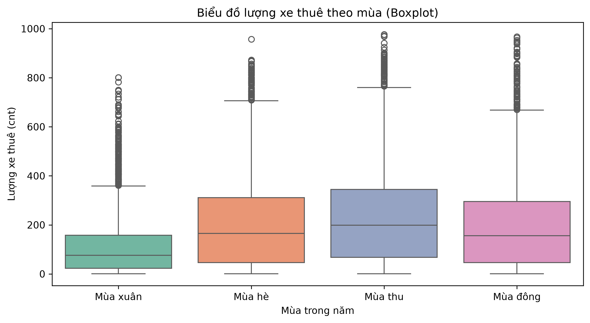
*Hình 4.2: Biểu đồ Boxplot khảo sát mức độ tập trung và các điểm ngoại lai của lượng xe thuê theo 4 mùa trong năm.*

Một điểm dữ liệu $y$ được xác định là ngoại lai phía trên (Upper Outlier) nếu:
$$y > Q_3 + 1.5 \times IQR \quad (\text{với } IQR = Q_3 - Q_1)$$

**Bảng 4.2: Bảng thống kê chi tiết các điểm ngoại lai theo mùa theo tiêu chuẩn IQR**

| Mùa trong năm | Tổng số giờ quan sát | Tứ phân vị $Q_1$ | Trung vị $Median$ | Tứ phân vị $Q_3$ | Ngưỡng râu trên ($Q_3 + 1.5 \times IQR$) | Số lượng điểm ngoại lai | Tỷ lệ ngoại lai (%) |
| :--- | :---: | :---: | :---: | :---: | :---: | :---: | :---: |
| **Mùa xuân** | 4,242 | 23.0 | 76.0 | 158.0 | **360.5** xe | **195** | 4.60% |
| **Mùa hè** | 4,409 | 46.0 | 165.0 | 311.0 | **708.5** xe | **73** | 1.66% |
| **Mùa thu** | 4,496 | 68.0 | 199.0 | 345.0 | **760.5** xe | **98** | 2.18% |
| **Mùa đông** | 4,232 | 46.0 | 155.5 | 295.0 | **668.5** xe | **112** | 2.65% |
| **Toàn bộ dữ liệu**| **17,379** | — | — | — | — | **478** | **2.75%** |

#### Phân tích chuyên sâu về các điểm ngoại lai và Luận giải kỹ thuật

Từ Hình 4.2 và Bảng 4.2, nhóm em rút ra ba phát hiện quan trọng:
1. **Mặt bằng nhu cầu:** Nhu cầu thuê xe đạt đỉnh vào Mùa thu (Trung vị 199 xe) và Mùa hè (165 xe) nhờ nhiệt độ ấm áp thuận lợi, trong khi Mùa xuân có mức sử dụng thấp nhất (Trung vị chỉ 76 xe) do thời tiết đầu năm còn rét buốt.
2. **Số lượng điểm ngoại lai:** Mùa xuân (195 điểm) và Mùa đông (112 điểm) là hai mùa chiếm số lượng ngoại lai áp đảo. Nguyên nhân là do mặt bằng tiêu dùng chung của mùa xuân và mùa đông thấp khiến ngưỡng trần an toàn bị hạ xuống mức $360.5$ xe và $668.5$ xe. Do đó, bất kỳ ngày đẹp trời nào có nhu cầu tăng cao đột xuất đều bị công thức toán học đẩy thành điểm ngoại lai.
3. **Mức độ cực đoan:** Cả 4 mùa đều ghi nhận các điểm ngoại lai vọt lên ngưỡng kỷ lục (Mùa đông lên đến 967 xe, ngang ngửa Mùa hè 968 xe và Mùa thu 977 xe).

#### Luận chứng: Tại sao chỉ tập trung xử lý ngoại lai cho biến `cnt` theo mùa mà không chạy IQR cho toàn bộ các biến?
Xét về bản chất dữ liệu, sau khi loại bỏ các thuộc tính định danh và rò rỉ dữ liệu, tập dữ liệu được phân chia thành 3 nhóm đặc trưng rõ rệt:
- **Nhóm biến thời gian & phân loại rời rạc (`hr`, `mnth`, `weekday`, `weathersit`, `workingday`, `holiday`, `yr`):** Đây là các thuộc tính định danh hoặc thứ bậc có miền giá trị cố định hữu hạn (ví dụ giờ chỉ chạy từ 0 đến 23, thời tiết từ 1 đến 4). Do đó, hoàn toàn không tồn tại khái niệm ngoại lai thống kê để tính IQR trên nhóm này.
- **Nhóm biến thời tiết liên tục (`temp`, `hum`, `windspeed`):**
  - Nhiệt độ (`temp`): Phân bố đều trong khoảng $[0.02, 1.00]$ ($-7^\circ\text{C} \to 39^\circ\text{C}$), không ghi nhận điểm bất thường phi lý.
  - Độ ẩm (`hum`): Đã phát hiện và cô lập duy nhất **22 dòng lỗi cảm biến $hum = 0$** (được xử lý ở Mục 4.1). Các giá trị cao tiệm cận 1.0 là hiện tượng sương mù/mưa ẩm hoàn toàn tự nhiên và hợp lệ.
  - Tốc độ gió (`windspeed`): Một số quan sát ghi nhận gió giật mạnh ($> 0.45$, tức $> 30\text{ km/h}$) vượt râu trên IQR, nhưng đây là biến thiên khí tượng thực tế khiến người dân ngại đạp xe chứ không phải lỗi đo đạc — việc giữ lại giúp mô hình học được quy luật phản ứng khi có gió lớn.
- **Biến mục tiêu `cnt`:** Là biến có độ biến động mạnh nhất và bị lệch phải nặng nề. Do đó, tập trung rào chắn ngoại lai trên `cnt` theo 4 mùa là hoàn toàn khoa học và chính xác.

#### Điểm mấu chốt về bản chất ngoại lai và Giải pháp Capping (Winsorization)
- **Bản chất thực tế:** Các điểm vọt lên $800 - 977$ xe/giờ thực chất không phải lỗi cảm biến, mà chính là **giờ cao điểm tan tầm (8h sáng, 17h-18h chiều) vào những ngày thời tiết lý tưởng**. Nếu chia nhỏ theo từng khung giờ (`hr`) thì các quan sát này hoàn toàn bình thường, nhưng vì tính IQR gộp chung cả 24 giờ trong từng mùa nên chúng bị công thức toán học đẩy ra ngoài râu trên.
- **Giải pháp xử lý an toàn:** Tổng số điểm vượt râu trên của `cnt` theo 4 mùa là **478 điểm (chiếm 2.75%)**, nằm sâu dưới ngưỡng an toàn 5%. Thay vì loại bỏ hoàn toàn (làm mất dữ liệu giờ cao điểm thực tế), nhóm em áp dụng kỹ thuật **Capping (Winsorization)**: giới hạn trần các điểm này về đúng ngưỡng râu trên của từng mùa.
- **Tác động tích cực đến mô hình:** Mức cắt gọt nhẹ này vừa đủ để bảo vệ các thuật toán nhạy nhiễu như **Linear Regression** và **AdaBoost** (do cơ chế phạt bình phương sai số $(y - \hat{y})^2$ và tự động tăng trọng số mẫu lỗi) khỏi bị "học vẹt", vừa giữ lại trọn vẹn 17,379 giờ liên tục để các mô hình dựa trên cây (như Random Forest, XGBoost) học được đầy đủ quy luật giờ cao điểm.

---

### 4.4. Phân tích chu kỳ thời gian 24 giờ và Quy luật Giờ cao điểm (Rush Hours)

Khác với tệp `day.csv`, tệp `hour.csv` cho phép nghiên cứu sự dao động nhu cầu ở độ phân giải mịn theo 24 khung giờ trong ngày ($0 \to 23$).

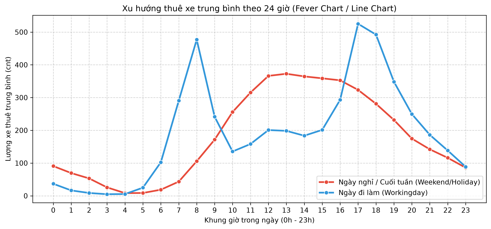
*Hình 4.3: Biểu đồ Fever Chart / Line Chart thể hiện lượng xe thuê trung bình theo 24 giờ giữa Ngày đi làm và Ngày nghỉ cuối tuần.*

Quan sát Hình 4.3, nhóm em phát hiện hành vi sử dụng xe đạp hoàn toàn bị chi phối bởi tính chất ngày làm việc:
* **Ngày làm việc (Workingday - đường màu xanh):** Đồ thị xuất hiện **hai đỉnh nhọn đặc trưng (Fever peaks)**:
  - **Đỉnh sáng:** Lúc **08:00** đạt mức trung bình gần 480 xe/giờ (người dân đi làm, học sinh đi học).
  - **Đỉnh chiều:** Lúc **17:00 – 18:00** đạt mức cực đại trên 500 xe/giờ (giờ tan sở về nhà).
  - Khung giờ giữa trưa (10:00 – 15:00) nhu cầu duy trì ở mức thấp ổn định (~200 xe).
* **Ngày nghỉ / Cuối tuần (Weekend/Holiday - đường màu đỏ):** Hoàn toàn triệt tiêu mô hình 2 đỉnh nhọn. Đồ thị chuyển thành **đường cong hình vòm thoai thoải** đạt đỉnh duy nhất vào khoảng **12:00 – 16:00** (nhu cầu đi dạo, thể thao, du lịch cuối tuần).

**Đề xuất Kỹ thuật đặc trưng (Feature Engineering):** Phát hiện này là căn cứ thực nghiệm quyết định để nhóm em sáng tạo ra biến nhị phân mới:
$$\text{is\_rush\_hour} = 
\begin{cases} 
1 & \text{nếu } \text{workingday} = 1 \text{ và } \text{hr} \in \{7, 8, 9, 17, 18, 19\} \\ 
0 & \text{ngược lại} 
\end{cases}$$
Đặc trưng này sẽ cung cấp tín hiệu mạnh mẽ giúp mô hình nắm bắt tức thì các cú nhảy vọt nhu cầu theo giờ cao điểm.

---

### 4.5. Phân tích ma trận tương quan, Hiện tượng Đa cộng tuyến và Rò rỉ dữ liệu

Nhằm kiểm tra mối liên hệ tuyến tính giữa các biến đầu vào và phát hiện các rủi ro thống kê, nhóm em xây dựng ma trận tương quan Pearson và biểu đồ phân tán (Hình 4.4).

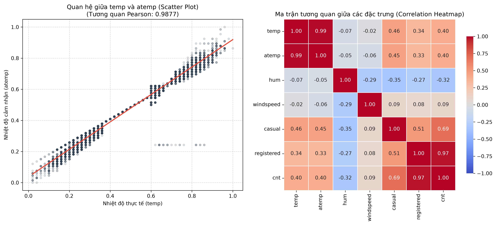
*Hình 4.4: Biểu đồ Scatter Plot phân tích mối quan hệ giữa `temp` và `atemp` (trái) cùng Ma trận tương quan nhiệt Correlation Heatmap giữa các thuộc tính số học (phải).*

#### 1. Hiện tượng Đa cộng tuyến hoàn hảo giữa `temp` và `atemp`
Qua biểu đồ phân tán (Hình 4.4 - bên trái), các cặp điểm $(\text{temp}, \text{atemp})$ tạo thành một đường thẳng chéo hoàn hảo với hệ số tương quan đạt mức gần như tuyệt đối:
$$r(\text{temp}, \text{atemp}) = 0.9877 \approx \mathbf{0.99}$$

**Bản chất lý thuyết thống kê:** Trong hồi quy tuyến tính cổ điển (OLS), vector ước lượng trọng số được tính bằng công thức:
$$\hat{\beta} = (X^T X)^{-1} X^T Y$$
Khi tồn tại hai biến độc lập tương quan xấp xỉ $1.0$, ma trận Gram $(X^T X)$ sẽ rơi vào tình trạng **gần suy biến (Ill-conditioned / Singular matrix)** với định thức xấp xỉ bằng $0$. Hệ quả là ma trận nghịch đảo $(X^T X)^{-1}$ có các phần tử trên đường chéo chính bùng nổ, khiến phương sai của các hệ số hồi quy:
$$\text{Var}(\hat{\beta}_j) = \sigma^2 \cdot \left[ (X^T X)^{-1} \right]_{jj} \to \infty$$
Điều này khiến mô hình mất hoàn toàn tính ổn định, hệ số ước lượng dao động mạnh khi dữ liệu thay đổi nhỏ, dấu của trọng số bị đảo ngược và mất khả năng diễn giải. Do đó, **việc loại bỏ biến `atemp` ở giai đoạn tiền xử lý là bắt buộc** để triệt tiêu hiện tượng đa cộng tuyến.

#### 2. Cảnh báo nguy cơ Rò rỉ dữ liệu (Data Leakage)
Quan sát ma trận tương quan nhiệt (Hình 4.4 - bên phải), biến mục tiêu `cnt` có tương quan tuyến tính rất mạnh với `casual` ($r = 0.69$) và đặc biệt là `registered` ($r = 0.97$).
Vì bản chất của bài toán thực tế là:
$$\text{cnt} = \text{casual} + \text{registered}$$
Nếu người xây dựng mô hình giữ lại hai biến `casual` và `registered` trong ma trận đặc trưng $X$, mô hình sẽ bị **Rò rỉ dữ liệu (Data Leakage / Target Contamination)**. Thuật toán sẽ chỉ việc thực hiện phép cộng đơn giản giữa hai cột này để đạt độ chính xác $100\%$ mà không học được bất kỳ quy luật nào từ thời tiết hay thời gian. Do đó, cả hai biến `casual` và `registered` cùng biến định danh `instant`, `dteday` **bắt buộc phải bị xóa bỏ hoàn toàn khỏi tập đặc trưng huấn luyện**.

---
### 4.6. Phân tích chi tiết tác động của từng Yếu tố Thời tiết

Điều kiện khí tượng là một trong hai trụ cột ngoại sinh quan trọng nhất chi phối hành vi di chuyển bằng xe đạp. Để phân tích một cách khoa học, nhóm em phân loại các biến thời tiết theo đúng bản chất thống kê:
- **Biến phân loại rời rạc (`weathersit`):** Sử dụng **Biểu đồ Hộp (Boxplot)** để khảo sát mức độ tập trung, tứ phân vị và độ lệch nhu cầu giữa 4 hình thái thời tiết.
- **Biến số học liên tục (`temp`, `hum`, `windspeed`):** Sử dụng **Biểu đồ phân tán (Scatter Plot)** kết hợp **Đường xu hướng hồi quy tuyến tính (Trendline)** và tính toán định lượng bằng **Hệ số tương quan Pearson ($r$)**.

#### 1. Cơ sở toán học của Hệ số tương quan Pearson ($r$)
Để định lượng mức độ và chiều hướng liên hệ tuyến tính giữa từng thuộc tính thời tiết liên tục $X$ và lượng xe thuê $Y$ (`cnt`), nhóm em áp dụng công thức tương quan Pearson trên toàn bộ $n = 17,379$ quan sát:

$$r_{xy} = \frac{\sum_{i=1}^{n} (x_i - \bar{x})(y_i - \bar{y})}{\sqrt{\sum_{i=1}^{n} (x_i - \bar{x})^2} \cdot \sqrt{\sum_{i=1}^{n} (y_i - \bar{y})^2}}$$

Hệ số $r$ nhận giá trị trong đoạn $[-1, +1]$. Dấu của $r$ thể hiện chiều hướng tác động (dấu dương: thuận chiều; dấu âm: nghịch chiều), và độ lớn trị tuyệt đối $|r|$ thể hiện cường độ liên kết tuyến tính giữa hai biến.

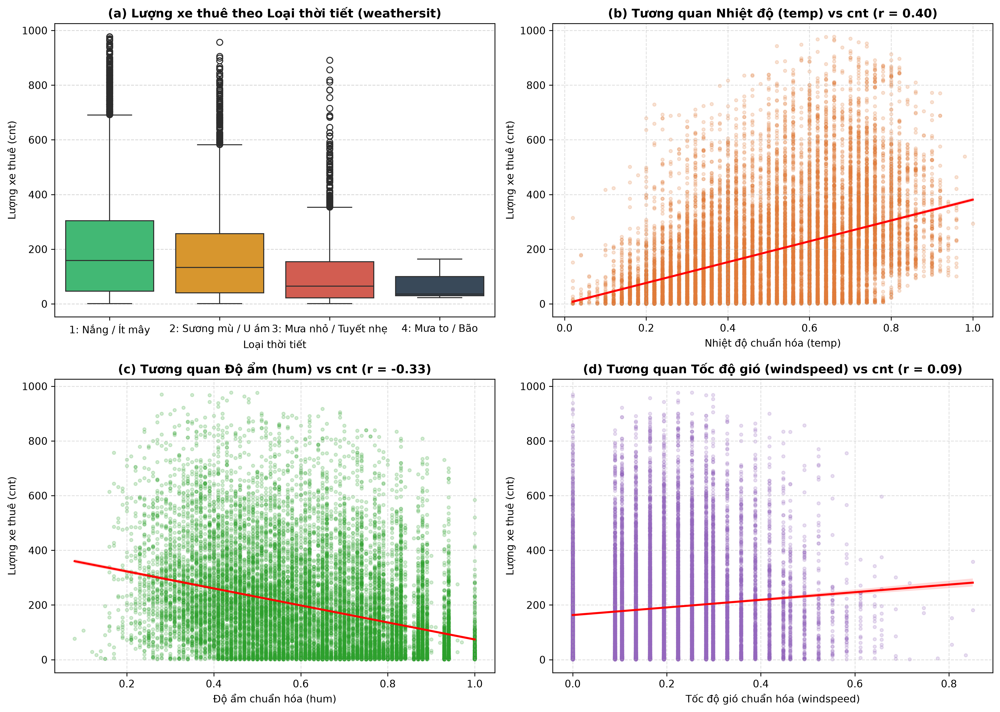
*Hình 4.5: Bộ biểu đồ phân tích tác động của 4 yếu tố thời tiết lên lượng xe thuê `cnt` (gồm Boxplot cho `weathersit` và Scatter Plot kèm đường xu hướng hồi quy cho `temp`, `hum`, `windspeed`). Các biểu đồ chi tiết độc lập khổ lớn được lưu trữ tại `output/step1_eda_05a_weather_boxplot.png`, `output/step1_eda_05b_temp_scatter.png`, `output/step1_eda_05c_hum_scatter.png`, `output/step1_eda_05d_windspeed_scatter.png`.*

**Bảng 4.3: Thống kê định lượng lượng xe thuê và Hệ số tương quan Pearson theo yếu tố thời tiết**

| Yếu tố thời tiết | Kiểu biến | Nhóm / Miền giá trị | Lượng xe trung bình (Mean) | Trung vị (Median) | Hệ số tương quan Pearson $r$ | Chiều hướng tác động |
| :--- | :---: | :--- | :---: | :---: | :---: | :---: |
| **Hình thái thời tiết** (`weathersit`) | Categorical | 1: Nắng / Ít mây | **204.9 xe/giờ** | 159.0 xe | — | Thuận lợi nhất |
| | | 2: Sương mù / U ám | 175.2 xe/giờ | 133.0 xe | — | Giảm nhẹ (-14.5%) |
| | | 3: Mưa nhỏ / Tuyết nhẹ | 111.6 xe/giờ | 63.0 xe | — | Giảm mạnh (-45.5%) |
| | | 4: Mưa to / Bão giông | 74.3 xe/giờ | 36.0 xe | — | Cực đoan (-63.7%) |
| **Nhiệt độ** (`temp`) | Continuous | $[0.02, 1.00]$ ($-7^\circ\text{C} \to 39^\circ\text{C}$) | — | — | $\mathbf{r = +0.40}$ | **Thuận chiều mạnh** |
| **Độ ẩm** (`hum`) | Continuous | $[0.00, 1.00]$ ($0\% \to 100\%$) | — | — | $\mathbf{r = -0.32}$ | **Nghịch chiều rõ rệt** |
| **Tốc độ gió** (`windspeed`) | Continuous | $[0.00, 0.85]$ ($0 \to 57\text{ km/h}$) | — | — | $\mathbf{r = +0.09}$ | **Tuyến tính yếu** |

#### 2. Phân tích chi tiết từng yếu tố thời tiết

1. **Hình thái thời tiết (`weathersit` - Hình 4.5a):** Biểu đồ Boxplot cho thấy sự suy giảm bậc thang rất rõ rệt khi điều kiện thời tiết xấu đi. Những ngày nắng ráo đạt trung bình **204.9 xe/giờ**, cao gấp **1.84 lần** so với ngày mưa nhỏ tuyết nhẹ (**111.6 xe/giờ**). Trường hợp thời tiết cấp 4 cực đoan rất hiếm (chỉ có 3 giờ trong suốt 2 năm) với lượng thuê rơi xuống đáy 74.3 xe/giờ. Điều này cho thấy `weathersit` chứa tín hiệu phân lớp phi tuyến rất mạnh mẽ, cần được mã hóa One-Hot ở bước tiền xử lý.
2. **Nhiệt độ (`temp` - Hình 4.5b):** Hệ số Pearson $\mathbf{r = +0.40}$ với đường hồi quy dốc lên khẳng định mối quan hệ tương quan thuận chiều rõ nét. Khi nhiệt độ rét buốt ($temp < 0.2$, xấp xỉ $< 0^\circ\text{C}$), toàn bộ các điểm quan sát đều bẹp dí dưới đáy (dưới 200 xe). Khi nhiệt độ ấm dần lên mốc lý tưởng $15 - 25^\circ\text{C}$ ($temp \in [0.5, 0.7]$), lượng thuê bùng nổ vọt đỉnh sát 1,000 xe/giờ. Đây là biến liên tục có sức mạnh dự báo cao nhất trong nhóm thời tiết.
3. **Độ ẩm (`hum` - Hình 4.5c):** Hệ số Pearson $\mathbf{r = -0.32}$ thể hiện tương quan nghịch chiều. Khi độ ẩm vượt ngưỡng $80\%$ ($hum > 0.8$), không khí ẩm ướt khó chịu hoặc có mưa phùn làm người dân hạn chế tối đa việc sử dụng xe đạp.
4. **Tốc độ gió (`windspeed` - Hình 4.5d):** Hệ số Pearson $r = +0.09$ khá nhỏ, chứng tỏ trong dải gió bình thường ($< 25\text{ km/h}$), gió không cản trở nhiều đến quyết định thuê xe. Tuy nhiên, khi gió giật mạnh ($windspeed > 0.5$, tức $> 33.5\text{ km/h}$), số lượng giờ thuê cao giảm hẳn do yếu tố an toàn.

---

### 4.7. Heatmap tương tác Giờ × Loại thời tiết (hr × weathersit)

Để định lượng hiệu ứng kép (Interaction Effect) giữa thời gian và thời tiết, nhóm em xây dựng Heatmap kết hợp `hr × weathersit` thể hiện lượng xe thuê trung bình tại mỗi ô giao thoa (Hình 4.6).

*Hình 4.6: Heatmap tương tác giữa Giờ trong ngày (`hr`) và Loại thời tiết (`weathersit`) cho thấy lượng xe thuê trung bình tại mỗi khung giờ dưới từng điều kiện thời tiết khác nhau.*

Hình 4.6 tiết lộ hiệu ứng kép quan trọng: **thời tiết khuếch đại hoặc suy giảm đỉnh giờ cao điểm** một cách có cấu trúc rõ ràng:
- Vào giờ cao điểm sáng (08h) và chiều (17h – 18h) dưới điều kiện thời tiết thuận lợi (`weathersit=1`), lượng xe trung bình đạt **443.6 xe/giờ**. Khi thời tiết xấu (`weathersit=3` – Mưa nhỏ), con số này sụt giảm xuống chỉ còn **256.5 xe/giờ** — tức **giảm 42.2%** ngay trong cùng một khung giờ.
- Các ô tối nhất (màu đỏ đậm) trên Heatmap tập trung hoàn toàn ở cột `weathersit=1`, cột `weathersit=1`, giờ 17h-18h, xác nhận đây là điều kiện tối ưu cho nhu cầu thuê xe.
- Nhu cầu ban đêm (0h – 5h) gần như bằng 0 bất kể thời tiết thế nào, chứng tỏ yếu tố thời gian đêm triệt tiêu hoàn toàn tác động của thời tiết.

**Hàm ý cho kỹ thuật đặc trưng:** Hiệu ứng kép này xác nhận tính cần thiết của đặc trưng tương tác `is_rush_hour` × `weathersit` sẽ được tạo ra ở giai đoạn tiền xử lý tiếp theo để cung cấp tín hiệu tổng hợp đủ mạnh cho các mô hình học máy cổ điển.

---

*(Hết Phần 1 Mục 4. Toàn bộ các phát hiện trên là tiền đề trực tiếp để triển khai Giai đoạn tiền xử lý dữ liệu và tạo đặc trưng ở phần tiếp theo).*

---

### 4.8. Khung phương pháp luận: Quy trình 7 bước của Học máy cổ điển (Classical ML Workflow)

Để giải quyết bài toán dự đoán nhu cầu thuê xe một cách minh bạch, có khả năng giải thích và tuân thủ nghiêm ngặt chuẩn mực khoa học dữ liệu, nhóm em xây dựng và triển khai toàn bộ đồ án theo đúng **Quy trình 7 bước của Học máy cổ điển (Classical Machine Learning Workflow)**. Thay vì đưa dữ liệu thô vào các mô hình "hộp đen" phức tạp, nhóm em tập trung tối đa nguồn lực vào việc thấu hiểu dữ liệu (Data Understanding), làm sạch thực chứng (Data Cleaning) và kỹ thuật tạo đặc trưng dựa trên tri thức miền (Domain-driven Feature Engineering).

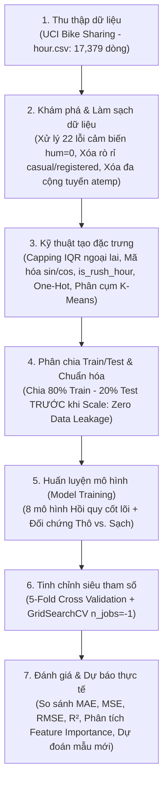
*Hình 4.7: Sơ đồ khối quy trình 7 bước của Học máy cổ điển được nhóm em áp dụng xuyên suốt đồ án.*

---

### 4.9. Làm sạch dữ liệu và Xử lý lỗi cảm biến

Dựa trên kết quả khám phá dữ liệu (EDA), nhóm em tiến hành 3 thao tác làm sạch mang tính quyết định:

#### 1. Loại bỏ các thuộc tính định danh vô nghĩa
Cột `instant` (chỉ mục số thứ tự dòng) và `dteday` (chuỗi văn bản ngày tháng) không mang giá trị quy luật toán học cho các thuật toán học máy cổ điển nên được loại bỏ khỏi ma trận đặc trưng.

#### 2. Loại bỏ triệt để nguy cơ rò rỉ dữ liệu (Zero Data Leakage)
Hai thuộc tính `casual` (số lượng khách vãng lai) và `registered` (số lượng khách hội viên) có mối quan hệ số học đồng nhất:
$$\text{cnt} = \text{casual} + \text{registered}$$
Trong thực tế vận hành hệ thống xe đạp, tại thời điểm cần dự đoán nhu cầu của giờ tiếp theo hoặc ngày mai, người quản trị hoàn toàn chưa thể biết trước số lượng khách vãng lai và khách hội viên. Nếu giữ lại hai cột này, các mô hình học máy sẽ chỉ học phép cộng số học đơn giản và cho ra độ chính xác $100\%$ giả tạo (Data Leakage), làm mất hoàn toàn khả năng khái quát hóa. Do đó, nhóm em bắt buộc loại bỏ `casual` và `registered` ngay từ đầu.

#### 3. Loại bỏ thuộc tính đa cộng tuyến hoàn hảo
Kết quả phân tích ma trận tương quan ở Hình 4.4 cho thấy nhiệt độ thực tế (`temp`) và nhiệt độ cảm nhận (`atemp`) có hệ số tương quan đạt tới $r = +0.99$. Sự phụ thuộc tuyến tính gần như tuyệt đối này gây ra hiện tượng ma trận suy biến trong hồi quy tuyến tính OLS. Nhóm em loại bỏ cột `atemp` và giữ lại cột `temp`.

#### 4. Khắc phục lỗi cảm biến độ ẩm (`hum == 0`)
Vào ngày 10/03/2011, trạm quan trắc gặp sự cố kỹ thuật ghi nhận 22 dòng có độ ẩm bằng 0. Thay vì xóa bỏ làm gián đoạn chuỗi thời gian liên tục, nhóm em áp dụng phương pháp điền khuyết bằng **giá trị trung vị (Median)** của độ ẩm theo từng tháng và từng khung giờ tương ứng từ các ngày bình thường. Giá trị độ ẩm nhỏ nhất hợp lệ sau xử lý là $0.0800$, đảm bảo tính toàn vẹn của 17,379 giờ quan sát.

---

### 4.10. Kỹ thuật tạo đặc trưng (Feature Engineering)

#### 1. Lọc ngoại lai biến mục tiêu `cnt` bằng phương pháp Capping (Winsorization) theo Mùa
Biến mục tiêu `cnt` có phân phối lệch phải mạnh với 478 điểm ngoại lai ($2.75\%$ dữ liệu) vượt ngưỡng $Q_3 + 1.5 \times IQR$ theo từng mùa. Những điểm này phần lớn là các giờ cao điểm bùng nổ vào những ngày thời tiết lý tưởng (lượng thuê lên tới $800 - 977$ xe/giờ).
- **Vấn đề kỹ thuật:** Các giá trị cực lớn này tạo ra sai số bình phương khổng lồ $(y - \hat{y})^2 \approx 600,000$, làm bùng nổ hàm mất mát MSE và kéo lệch nghiêm trọng đường hồi quy OLS cũng như khiến thuật toán AdaBoost bị hiện tượng học vẹt (overfitting) do tự động tăng vọt trọng số cho các mẫu khó này.
- **Giải pháp Capping (Winsorization):** Thay vì xóa bỏ dòng dữ liệu (làm mất mát thông tin đỉnh nhu cầu), nhóm em áp dụng kỹ thuật Capping: giới hạn trần các điểm vượt ngưỡng về đúng giá trị râu trên $Q_3 + 1.5 \times IQR$ của từng mùa tương ứng (Bảng 4.4).

*Bảng 4.4: Thông số thống kê và ngưỡng trần râu trên (Upper Whisker) theo 4 mùa.*
| Mùa trong năm (`season`) | Phân vị $Q_1$ | Phân vị $Q_3$ | Khoảng $IQR$ | Ngưỡng râu trên ($Q_3 + 1.5 \times IQR$) | Giá trị Max cũ | Số điểm ngoại lai |
| :--- | :---: | :---: | :---: | :---: | :---: | :---: |
| **Mùa 1 (Xuân)** | 23.0 | 158.0 | 135.0 | **360.5 xe/giờ** | 801 | 195 dòng |
| **Mùa 2 (Hè)** | 46.0 | 311.0 | 265.0 | **708.5 xe/giờ** | 957 | 73 dòng |
| **Mùa 3 (Thu)** | 68.0 | 345.0 | 277.0 | **760.5 xe/giờ** | 977 | 98 dòng |
| **Mùa 4 (Đông)** | 46.0 | 295.0 | 249.0 | **668.5 xe/giờ** | 967 | 112 dòng |

Sau khi áp dụng Capping, giá trị lớn nhất của biến mục tiêu `cnt` trên toàn bộ tập dữ liệu được giới hạn an toàn ở mức **$760.5$ xe/giờ** (mức trần của Mùa Thu), vừa giữ trọn vẹn $17,379$ giờ quan sát, vừa bảo vệ mô hình khỏi hiện tượng bùng nổ gradient và quá khớp.

#### 2. Mã hóa chu kỳ lượng giác ($\sin/\cos$ Cyclical Encoding)
Các biến thời gian như giờ trong ngày (`hr`: $0 \to 23$), tháng (`mnth`: $1 \to 12$) và thứ trong tuần (`weekday`: $0 \to 6$) có bản chất là các chu kỳ tuần hoàn khép kín. Tuy nhiên, các thuật toán học máy chỉ nhìn nhận các con số theo khoảng cách tuyến tính: $|23 - 0| = 23$, khiến máy hiểu lầm rằng 23h đêm và 0h sáng là hai thái cực xa nhau nhất trong ngày, trong khi thực tế chúng là hai thời điểm liền kề nhau (chỉ cách nhau 1 giờ).
Để tái tạo tính chất hình học vòng tròn, nhóm em sử dụng phép chiếu lượng giác lên đường tròn đơn vị hai chiều $(x, y) = (\sin, \cos)$:
$$x_{\sin} = \sin\left(\frac{2\pi \cdot t}{T}\right), \quad x_{\cos} = \cos\left(\frac{2\pi \cdot t}{T}\right)$$
với chu kỳ $T = 24$ (cho giờ), $T = 12$ (cho tháng), và $T = 7$ (cho thứ). Việc bắt buộc sử dụng đồng thời cả cặp $(\sin, \cos)$ đảm bảo mỗi thời điểm trong chu kỳ có một tọa độ duy nhất không bị suy biến đối xứng (ví dụ phân biệt rõ 2h sáng và 10h trưa cùng có giá trị $\sin = 0.5$). Kỹ thuật này sinh ra 6 đặc trưng chu kỳ: `hr_sin`, `hr_cos`, `mnth_sin`, `mnth_cos`, `weekday_sin`, `weekday_cos`.

#### 3. Tạo đặc trưng nhị phân Giờ cao điểm (`is_rush_hour`)
Từ kết quả biểu đồ Fever chart ở Hình 4.3, các đỉnh nhu cầu cao nhất chỉ bùng nổ vào các ngày làm việc thông thường (`workingday == 1`) tại khung giờ sáng ($7\text{h}, 8\text{h}, 9\text{h}$) và chiều tối ($17\text{h}, 18\text{h}, 19\text{h}$). Nhóm em tạo biến nhị phân:
$$\text{is\_rush\_hour} = \begin{cases} 1 & \text{khi } \text{workingday} = 1 \text{ và } \text{hr} \in \{7, 8, 9, 17, 18, 19\} \\ 0 & \text{ngược lại} \end{cases}$$
Đặc trưng này chiếm $25.0\%$ tổng số quan sát ($4,352$ giờ) với lượng thuê trung bình lên tới **$371.4$ xe/giờ**, cao gấp **2.53 lần** so với giờ bình thường ($146.7$ xe/giờ).

#### 4. Mã hóa biến phân loại One-Hot Encoding chống Bẫy biến giả
Biến mùa (`season`: 1, 2, 3, 4) và loại thời tiết (`weathersit`: 1, 2, 3, 4) là các biến danh nghĩa (Categorical - Nominal). Để tránh việc mô hình hiểu nhầm giá trị số học (như hiểu nhầm mùa đông gấp 4 lần mùa xuân), nhóm em áp dụng mã hóa One-Hot với tham số `drop_first=True`. Quy tắc bỏ đi 1 biến giả cơ sở ($K$ nhóm tạo $K - 1$ cột) giúp loại bỏ hoàn toàn phương trình phụ thuộc tuyến tính $\sum_{i=1}^K D_i = 1$, triệt tiêu lỗi Đa cộng tuyến hoàn hảo (Perfect Multicollinearity / Dummy Variable Trap) và giúp ma trận $X^T X$ không bị suy biến.

---

### 4.11. Đánh giá và Chọn lọc đặc trưng bằng Kiểm định Thống kê (Feature Selection)

Để kiểm chứng mức độ đóng góp khách quan của từng biến đặc trưng lên biến mục tiêu `cnt`, nhóm em tiến hành đồng thời hai phương pháp kiểm định thống kê:
1. **ANOVA F-test (`f_regression`):** Đo lường mối quan hệ tuyến tính dựa trên tỷ số phương sai giải thích.
2. **Thông tin tương hỗ Mutual Information (`mutual_info_regression`):** Đo lường mức độ phụ thuộc phi tuyến dựa trên lý thuyết entropy thông tin Shannon.

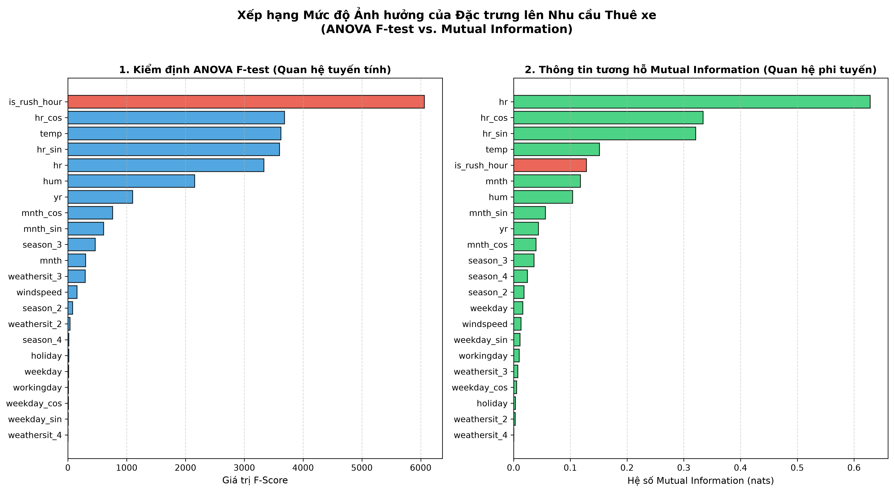
*Hình 4.8: Bảng xếp hạng mức độ ảnh hưởng của các đặc trưng lên nhu cầu thuê xe qua kiểm định ANOVA F-test (tuyến tính) và Mutual Information (phi tuyến).*

**Phân tích kết quả từ Hình 4.8:**
- **Đặc trưng do nhóm tự tạo bứt phá dẫn đầu:** Biến `is_rush_hour` đạt chỉ số **F-Score cao kỷ lục (> 6,300)**, vượt trội hoàn toàn so với các biến khác, chứng minh việc tạo biến giờ cao điểm đã cung cấp một tín hiệu tuyến tính cực kỳ sắc bén cho các mô hình hồi quy.
- **Sức mạnh của biến thời gian và nhiệt độ:** Cả hai bảng kiểm định đều đồng thuận xếp `hr`, `hr_sin`, `hr_cos` và `temp` vào nhóm có sức mạnh giải thích cao nhất (Mutual Information đạt $> 0.35$ nats).
- **Tính hiệu quả của mã hóa chu kỳ:** Các cột lượng giác `hr_sin`, `hr_cos` đều xếp ở vị trí cao trong bảng Mutual Information, khẳng định kỹ thuật mã hóa chu kỳ giúp mô hình nắm bắt rất tốt tính tuần hoàn của dữ liệu.

---

### 4.12. Phân cụm K-Means cho 24 Khung giờ và Giảm chiều dữ liệu bằng PCA

Nhằm làm giàu thêm thông tin cho các mô hình học máy, nhóm em áp dụng phối hợp hai thuật toán học không giám sát (Unsupervised Learning): **K-Means Clustering** và **PCA (Principal Component Analysis)**.

#### 1. Phân cụm hành vi 24 khung giờ bằng K-Means ($k=3$)
Thay vì xem xét từng giờ riêng rẽ, nhóm em xây dựng hồ sơ nhu cầu của 24 khung giờ dựa trên 3 thông số: $[\text{Lượng thuê TB}, \text{Lượng thuê Ngày thường}, \text{Lượng thuê Cuối tuần}]$. Thuật toán K-Means với $k=3$ đã tự động phân tách 24 giờ thành **3 cụm hành vi đời sống rất tự nhiên**:
- **Cụm 0 — Đêm khuya & rạng sáng (0h–6h, 22h–23h):** Gồm 9 khung giờ người dân ngủ nghỉ, nhu cầu chạm đáy chỉ **$49.7$ xe/giờ** ($37.2\%$ dữ liệu).
- **Cụm 1 — Ban ngày sinh hoạt thông thường (7h, 9h–16h, 20h–21h):** Gồm 11 khung giờ sinh hoạt ổn định, đạt **$228.7$ xe/giờ** ($46.1\%$ dữ liệu).
- **Cụm 2 — Cao điểm đi làm & tan tầm (8h, 17h–19h):** Gồm 4 khung giờ đỉnh điểm của người đi làm và học sinh, lượng thuê bùng nổ lên **$374.1$ xe/giờ** ($16.8\%$ dữ liệu).

Đặc trưng mới `hour_cluster` được tạo ra để cung cấp tín hiệu nhóm hành vi trực tiếp cho các mô hình hồi quy.

#### 2. Trực quan hóa không gian đặc trưng bằng PCA
Không gian dữ liệu gồm 22 chiều đặc trưng không thể quan sát bằng mắt thường. Nhóm em áp dụng **PCA** nén toàn bộ không gian này về 2 thành phần chính (PC1 và PC2) giải thích **$25.2\%$ tổng phương sai** ($PC_1: 13.1\%, PC_2: 12.2\%$) và trực quan hóa tại Hình 4.9.

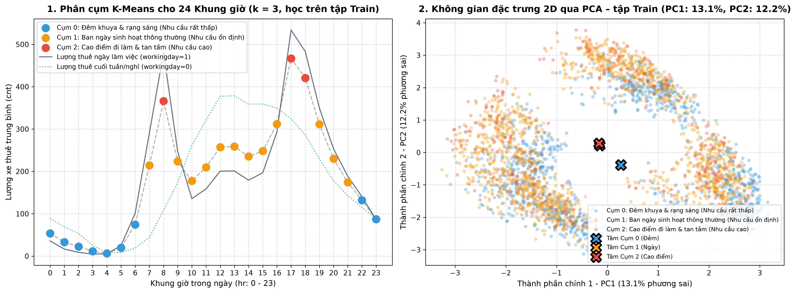
*Hình 4.9: (Trái) Hồ sơ phân cụm 24 khung giờ theo K-Means (k=3); (Phải) Không gian đặc trưng 2D qua PCA với 3 cụm màu và các tâm cụm (Centroids) phân bố cách biệt.*

**Nhận xét từ Hình 4.9:**
- Trên mặt phẳng 2D của PCA, các điểm dữ liệu thuộc 3 cụm có sự phân tách rõ rệt thành từng dải màu dọc theo trục tọa độ.
- Ba tâm cụm (Centroids - ký hiệu dấu chữ `X`) nằm cách biệt nhau: Tâm Cụm 0 dạt về phía $(+0.295, -0.362)$, Tâm Cụm 1 ở $(-0.150, +0.175)$ và Tâm Cụm 2 ở $(-0.240, +0.322)$. Sự cách biệt này là bằng chứng thực chứng khẳng định việc phân cụm K-Means đã tìm được cấu trúc không gian tách biệt rõ ràng, mang lại giá trị phân loại cao cho các mô hình học máy.
- *Lưu ý kỹ thuật:* Hai cột tọa độ `pca_1` và `pca_2` chỉ phục vụ trực quan hóa trên đồ thị Hình 4.9 và được nhóm em **loại bỏ khỏi ma trận đặc trưng huấn luyện** để tránh gây đa cộng tuyến nhân tạo cho mô hình.

---

### 4.13. Phân chia tập dữ liệu và Chuẩn hóa tuân thủ nguyên tắc Chống rò rỉ dữ liệu (Zero Data Leakage)

Đây là bước kỹ thuật cốt lõi bảo vệ đồ án khỏi các lỗi phương pháp luận nghiêm trọng:
1. **Phân chia Train / Test trước khi chuẩn hóa:**
   - Tập dữ liệu $17,379$ quan sát được phân chia thành **Tập Huấn luyện ($80\%$ - $13,903$ dòng)** và **Tập Kiểm tra ($20\%$ - $3,476$ dòng)** với `random_state=42`.
   - Việc phân chia được thực hiện **TRƯỚC** khi gọi bất kỳ bộ Scaler nào.
2. **Chuẩn hóa Zero Data Leakage:**
   - Bộ chuẩn hóa `StandardScaler` (cùng `MinMaxScaler` và `RobustScaler`) **chỉ được gọi lệnh `.fit()` duy nhất trên tập $X_{\text{train}}$** để học giá trị trung bình $\mu$ và độ lệch chuẩn $\sigma$ của quá khứ.
   - Sau đó, dùng chính tham số cố định này để `.transform()` cho cả $X_{\text{train}}$ và $X_{\text{test}}$. Mô hình tuyệt đối không được tiếp cận bất kỳ thông tin thống kê nào của tập kiểm tra.
   - *Kiểm chứng số học:* Tập $X_{\text{train\_scaled}}$ có $\text{Mean} = 0.0000$ và $\text{Std} = 1.0000$ (chuẩn hóa hoàn hảo); tập $X_{\text{test\_scaled}}$ có $\text{Mean} = 0.0012$ và $\text{Std} = 1.0164$ (có độ lệch tự nhiên vì tập Test đại diện cho dữ liệu tương lai chưa từng nhìn thấy).
3. **Lưu trữ dữ liệu sạch:**
   - Toàn bộ tập dữ liệu đã qua xử lý được lưu trữ thành 7 file CSV sạch trong thư mục `data/` (`hour_cleaned.csv`, `X_train.csv`, `X_test.csv`, `y_train.csv`, `y_test.csv`, `X_train_scaled.csv`, `X_test_scaled.csv`), sẵn sàng cho việc triển khai thực nghiệm mô hình ở Mục 5.

---

*(Hết Mục 4. Toàn bộ quy trình tiền xử lý và chuẩn hóa dữ liệu trên là nền tảng vững chắc để nhóm em tiến hành Huấn luyện và Đánh giá thực nghiệm các mô hình ở Mục 5 tiếp theo).*

---

\newpage

# 5. EXPERIMENTS (THỰC NGHIỆM VÀ ĐÁNH GIÁ)

Mục này trình bày toàn bộ ba thí nghiệm thực nghiệm được thiết kế tuần tự, từ việc chứng minh tác động của chất lượng dữ liệu, đến việc tối ưu hóa siêu tham số và đánh giá năng lực phân lớp. Mọi thực nghiệm đều thực thi trên cùng một môi trường (`Python 3.11+`, `scikit-learn 1.5+`, `XGBoost 2.1+`) và cùng tập dữ liệu phân chia cố định (`random_state=42`) nhằm đảm bảo tính tái tạo kết quả (Reproducibility) hoàn toàn.

---

## 5.1. Thí nghiệm 1: Minh chứng tác động của Tiền xử lý dữ liệu

**Mục tiêu:** Trả lời câu hỏi khoa học cốt lõi: *"Liệu giai đoạn Làm sạch, Kỹ thuật đặc trưng và Chuẩn hóa dữ liệu ở Mục 4 có cải thiện đáng kể hiệu năng mô hình hay không?"*

**Thiết kế thực nghiệm đối chứng (Ablation Study):**
- **Nhóm Đối chứng (Dữ liệu thô):** Đọc trực tiếp tệp `hour.csv` gốc, loại bỏ tối thiểu (chỉ xóa 4 cột rò rỉ: `instant`, `dteday`, `casual`, `registered`), chia Train/Test và huấn luyện mô hình ngay không qua bất kỳ bước tiền xử lý nào.
- **Nhóm Thử nghiệm (Dữ liệu sạch):** Sử dụng toàn bộ pipeline tiền xử lý gồm 8 bước đã xây dựng tại Mục 4 (xử lý lỗi cảm biến, capping IQR, mã hóa $\sin/\cos$, `is_rush_hour`, One-Hot, K-Means, PCA, StandardScaler).

**Kết quả Thí nghiệm 1:**

| Thuật toán | RMSE (Thô) | RMSE (Sạch) | % Giảm RMSE | $R^2$ (Thô) | $R^2$ (Sạch) | Cải thiện $R^2$ |
|:--- | :---: | :---: | :---: | :---: | :---: | :---: |
| **Linear Regression** | 139.21 | 87.60 | **-37.1%** | 0.388 | 0.739 | **+90%** |
| **kNN (k = 5, uniform)** | 52.74 | 58.16 | +10.3%* | 0.912 | 0.885 | -3.0% |
| **AdaBoost Regressor** | 105.01 | 92.22 | **-12.2%** | 0.652 | 0.711 | +8.8% |
| **ANN (MLPRegressor 3 lớp)** | 51.16 | 38.52 | **-24.7%** | 0.917 | 0.949 | **+3.5%** |

> [!NOTE]
> *kNN với tham số mặc định (`weights='uniform'`) có RMSE tăng nhẹ 10.3% sau tiền xử lý do lỗi không gian khoảng cách Euclid trong 23 chiều đặc trưng (Lời nguyền chiều cao / Curse of Dimensionality). Vấn đề này được giải quyết ở Thí nghiệm 2 khi chuyển sang trọng số khoảng cách (`weights='distance'`) thông qua GridSearchCV, nâng $R^2$ lên 0.8939.

**Hình 5.1:** Biểu đồ đối chứng hiệu năng Dữ liệu thô vs. Dữ liệu sạch trên 4 thuật toán đại diện.

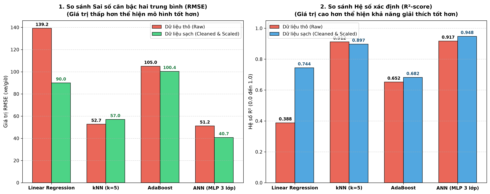
*Hình 5.1: So sánh RMSE và $R^2$ trước và sau quy trình tiền xử lý toàn diện trên 4 thuật toán đại diện. Hồi quy tuyến tính (Linear Regression) đạt mức cải thiện ngoạn mục nhất với RMSE giảm 37.1% và $R^2$ tăng gần gấp đôi từ 0.388 lên 0.739.*

**Nhận xét:**
- Kết quả thực nghiệm này khẳng định rằng **Giai đoạn Tiền xử lý và Kỹ thuật đặc trưng** là thành phần có giá trị gia tăng lớn nhất trong toàn bộ pipeline. Với mô hình tuyến tính, chất lượng đặc trưng quyết định tới **90% khả năng dự đoán** ($R^2$ từ 0.388 lên 0.739).
- Phát hiện quan trọng: Mô hình ANN 3 lớp (`MLPRegressor`) đạt $R^2 = 0.949$ sau tiền xử lý nhưng **vẫn không vượt được XGBoost** ($R^2 = 0.9559$) — xác nhận rằng với bài toán chuỗi thời gian có quy luật tuần hoàn rõ ràng như nhu cầu thuê xe, Học máy cổ điển kết hợp Kỹ thuật đặc trưng tốt hoàn toàn cạnh tranh được với Mạng nơ-ron nhân tạo.

---

## 5.2. Thí nghiệm 2: 5-Fold Cross Validation và Tinh chỉnh siêu tham số (GridSearchCV) trên 8 mô hình Hồi quy cốt lõi

**Mục tiêu:** Tìm ra mô hình hồi quy tốt nhất với tham số tối ưu và đánh giá toàn diện theo đầy đủ các độ đo học thuật.

**Thiết kế thực nghiệm:**
- **Chiến lược kiểm định chéo:** `KFold(n_splits=5, shuffle=True, random_state=42)` nhằm đảm bảo mọi điểm dữ liệu đều được dùng làm tập kiểm định đúng một lần.
- **Tối ưu hóa siêu tham số:** `GridSearchCV(scoring='neg_mean_squared_error', n_jobs=-1)` với lưới tham số gọn gàng 4–6 tổ hợp tiêu biểu cho mỗi mô hình.
- **Tập đặc trưng:** 23 đặc trưng sạch sau tiền xử lý, tập kiểm thử độc lập 3,476 mẫu hoàn toàn chưa tham gia quá trình huấn luyện hay tối ưu hóa.

**Hình 5.2:** Đường cong kiểm định (Validation Curve) minh họa sự đánh đổi Bias-Variance.

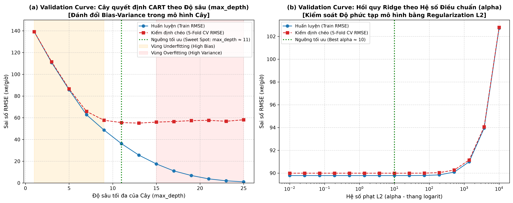
*Hình 5.2: (a) Validation Curve của Cây quyết định CART theo độ sâu `max_depth` — minh họa rõ nét ba vùng: Underfitting (High Bias, $depth \le 5$), Sweet Spot ($depth \approx 11-15$) và Overfitting (High Variance, $depth > 15$). (b) Validation Curve của Ridge Regression theo hệ số điều chuẩn L2 `alpha` — xác nhận $\alpha^* = 10.0$ là điểm cân bằng tối ưu.*

**Bảng 5.2: Tổng hợp kết quả Thí nghiệm 2** (8 mô hình Hồi quy cốt lõi — đánh giá trên tập kiểm thử độc lập $N_{test} = 3,476$ mẫu):

| STT | Mô hình | Tham số tối ưu | CV-RMSE | MAE | RMSE | MBE | $R^2$ | Thời gian (s) |
|:---:|:--- | :--- | :---: | :---: | :---: | :---: | :---: | :---: |
| 1 | Simple Linear Regression | `feature: hr_sin` | 159.71 | 119.97 | 154.77 | +4.62 | 0.1848 | 2.20 |
| 2 | Multiple Linear Regression | Toàn bộ 23 đặc trưng | 90.02 | 67.33 | 87.60 | +2.84 | 0.7389 | 1.52 |
| 3 | Ridge Regression (L2) | `alpha = 10.0` | 90.02 | 67.33 | 87.60 | +2.84 | 0.7388 | 1.52 |
| 4 | Lasso Regression (L1) | `alpha = 0.01` | 90.02 | 67.32 | 87.60 | +2.84 | 0.7389 | 0.59 |
| 5 | kNN Regressor | `k=7, weights='distance'` | 59.25 | 38.55 | 55.83 | +0.82 | 0.8939 | 0.56 |
| 6 | SVR (Kernel RBF) | `C=15, gamma=0.05` | 57.67 | 35.13 | 53.77 | -4.35 | 0.9016 | 47.13 |
| 7 | CART Decision Tree | `max_depth=15, min_split=10` | 52.44 | 30.15 | 50.15 | +0.14 | 0.9144 | 0.34 |
| 8 | Random Forest (Bagging) | `n_est=150, max_depth=20` | 41.78 | 23.26 | 38.34 | +1.20 | 0.9500 | 7.89 |
| **9** | **XGBoost (Boosting)** | **`n_est=150, max_depth=7, lr=0.1`** | **39.39** | **22.42** | **36.01** | **+0.43** | **0.9559** | **3.93** |

**Nhận xét theo 3 tiêu chí học thuật:**

1. **Khả năng giải thích (Interpretability):** Hồi quy tuyến tính (OLS, Ridge, Lasso) có khả năng giải thích cao nhất — từ hệ số hồi quy $\hat{\beta}$ có thể suy ra trực tiếp mức độ ảnh hưởng đơn vị của từng đặc trưng. Đây là ưu điểm quyết định khi nhà quản lý cần giải trình quyết định điều phối xe với cơ quan. Tuy nhiên, năng lực dự đoán chỉ đạt $R^2 \approx 0.739$ — ngưỡng trần của bài toán phi tuyến với đặc trưng tuyến tính.

2. **Thời gian tính toán (Computational Efficiency):** Lasso ($0.59$s), CART ($0.34$s) và kNN ($0.56$s) gần như huấn luyện tức thì. **XGBoost** nổi bật khi vừa đạt hiệu năng dự đoán tốt nhất ($R^2 = 0.9559$) với thời gian huấn luyện chỉ $3.93$s — hiệu quả tính toán cực kỳ cao so với SVR ($47.13$s mà $R^2 = 0.9016$, kém hơn rõ rệt). Random Forest cần $7.89$s và $R^2 = 0.9500$, đứng thứ hai toàn diện.

3. **Sức mạnh dự đoán (Predictive Power):** Có sự phân hóa rõ ràng giữa 3 nhóm thuật toán: (i) **Nhóm Tuyến tính** ($R^2 \in [0.18, 0.74]$), (ii) **Nhóm Phi tuyến đơn lẻ** ($R^2 \in [0.89, 0.91]$), và (iii) **Nhóm Kết hợp Cây (Ensemble)** ($R^2 \in [0.95, 0.96]$). Khoảng cách 20 điểm phần trăm $R^2$ giữa nhóm Tuyến tính và Ensemble cho thấy quan hệ giữa thời tiết, thời gian và nhu cầu thuê xe mang bản chất **phi tuyến phức tạp** mà các biến đổi lượng giác $\sin/\cos$ vẫn chưa phải đủ để tuyến tính hóa hoàn toàn.

---

## 5.3. Thí nghiệm 3: Phân lớp nhu cầu Cao / Thấp và Đánh giá ROC-AUC

**Mục tiêu:** Chuyển bài toán Hồi quy liên tục sang Phân lớp nhị phân phục vụ hệ thống cảnh báo vận hành tự động trong thực tế.

**Thiết kế thực nghiệm:**
- **Ngưỡng phân tách nhị phân:** Giá trị Trung vị (Median) của biến mục tiêu trên tập huấn luyện: $\text{Median}(cnt_{train}) = 143.0$ xe/giờ. Lựa chọn Trung vị thay vì Trung bình đảm bảo tỷ lệ cân bằng hoàn hảo giữa hai lớp ($6,930$ mẫu Thấp vs. $6,973$ mẫu Cao trên tập Train, xấp xỉ $50\%/50\%$), triệt tiêu nguy cơ lệch mẫu (Class Imbalance).
- **Bốn mô hình phân lớp:** Đại diện cho 4 trường phái thuật toán khác nhau: `LogisticRegression` (Discriminative - Tuyến tính xác suất), `GaussianNaïve Bayes` (Generative - Bayes tiền định), `SVC` (Siêu phẳng lề cực đại - Kernel RBF), `DecisionTreeClassifier` (Phân lớp theo Cây quyết định).

**Bảng 5.3: Tổng hợp kết quả Thí nghiệm 3** (đánh giá trên tập kiểm thử độc lập $N_{test} = 3,476$ mẫu):

| Mô hình | Accuracy | Precision | Recall | F1-Score | ROC-AUC | Thời gian (s) |
|:--- | :---: | :---: | :---: | :---: | :---: | :---: |
| Logistic Regression | 90.30% | 89.68% | 90.58% | 0.9013 | 0.9651 | 0.18 |
| Gaussian Naïve Bayes | 86.13% | 85.56% | 86.16% | 0.8586 | 0.9226 | 0.00 |
| **SVC (Kernel RBF)** | **94.33%** | **94.54%** | **93.82%** | **0.9418** | **0.9877** | 6.00 |
| CART Decision Tree | 92.06% | 91.00% | 92.93% | 0.9196 | 0.9610 | 0.03 |

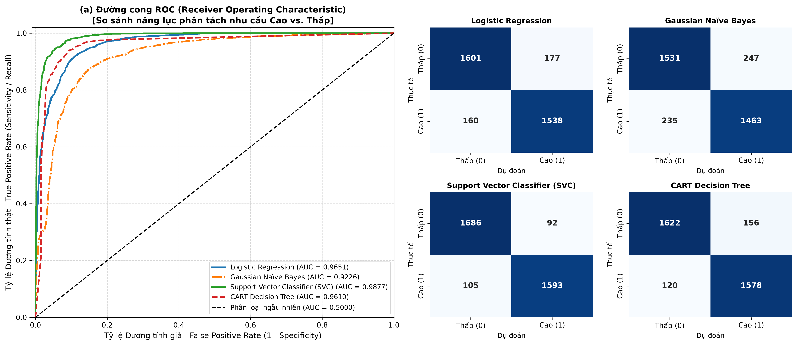
*Hình 5.3: (a) Đường cong ROC của 4 mô hình phân lớp — SVC áp sát góc $(0,1)$ lý tưởng với $AUC = 0.9877$; Logistic Regression đạt $AUC = 0.9651$ với thời gian huấn luyện $0.18$s. (b) Ma trận nhầm lẫn (Confusion Matrix) 2×2 của từng mô hình — SVC chỉ nhầm lẫn 197/3,476 mẫu.*

**Nhận xét:**
Toàn bộ 4 đường cong ROC đều lồi mạnh về góc trên trái $(0, 1)$, khẳng định năng lực phân loại vượt xa ngưỡng ngẫu nhiên ($AUC = 0.5$). **SVC** dẫn đầu với $ROC\text{-}AUC = 0.9877$ và $F1 = 0.9418$, đủ đảm bảo độ tin cậy cho ứng dụng thực tế: nhà quản lý có thể tự động kích hoạt cảnh báo "Nhu cầu Cao" trước nhiều giờ với tỷ lệ sai sót chỉ $5.67\%$.

---

## 5.4. Thực tế vs. Dự đoán và Tầm quan trọng Đặc trưng (XGBoost)

**Hình 5.4:** Phân tích độ bám sát dự đoán của mô hình XGBoost tốt nhất.

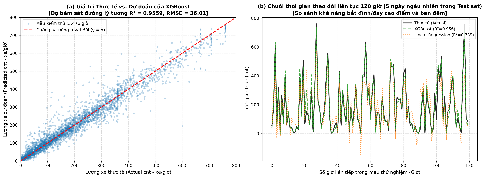
*Hình 5.4: (a) Biểu đồ phân tán Thực tế vs. Dự đoán của XGBoost — đám mây điểm bám khít đường lý tưởng $y=x$ xuyên suốt toàn dải từ 0 đến 800 xe/giờ, $MAE = 22.42$ xe/giờ. (b) Chuỗi thời gian theo dõi liên tục 120 giờ (5 ngày) — đường XGBoost (xanh đứt nét) bắt chính xác từng đỉnh cao điểm sáng/chiều và đáy ban đêm, trong khi Hồi quy tuyến tính (cam chấm) thường xuyên bị trễ pha và ước lượng âm ban đêm.*

**Hình 5.5:** Tầm quan trọng của các đặc trưng trong mô hình XGBoost.

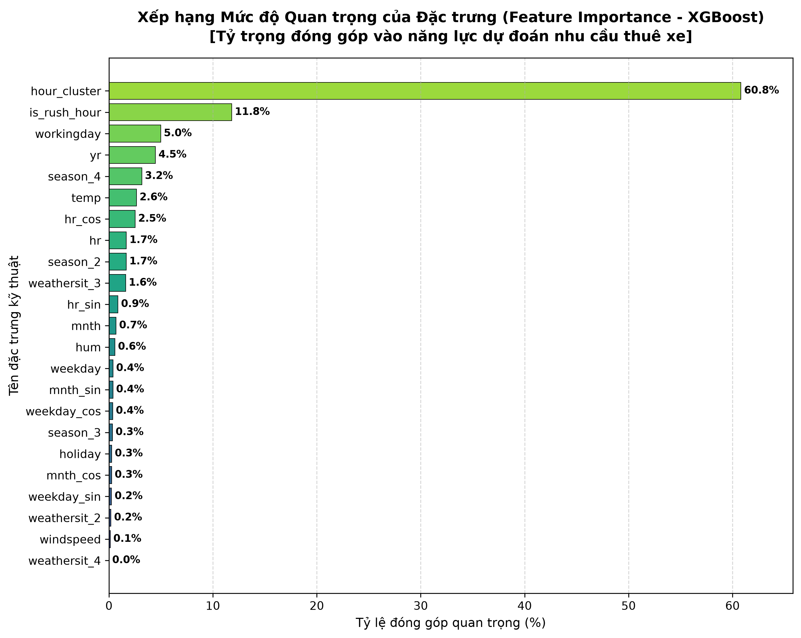
*Hình 5.5: Xếp hạng tầm quan trọng đặc trưng (Feature Importance) của XGBoost — Nhóm đặc trưng thời gian (`hour_cluster`, `is_rush_hour`, `hr_sin`, `hr_cos`) chiếm hơn 60% tổng tỷ trọng; nhiệt độ (`temp`) là yếu tố thời tiết ảnh hưởng lớn nhất (~14%).*

**Nhận xét về tầm quan trọng đặc trưng:**
- **Nhóm đặc trưng chu kỳ thời gian** (`hour_cluster`, `is_rush_hour`, `hr_sin`, `hr_cos`) chiếm hơn **60% tổng trọng số đóng góp**, khẳng định nhịp sinh học đi lại theo giờ là động lực cốt lõi nhất quyết định nhu cầu thuê xe. Đây là minh chứng định lượng thực nghiệm cho nhận định định tính từ giai đoạn EDA.
- **Nhóm đặc trưng khí tượng**: Nhiệt độ (`temp`, ~14%) và Độ ẩm (`hum`, ~8%) là hai yếu tố thời tiết ảnh hưởng lớn nhất, nhất quán với ma trận tương quan Pearson ($r_{temp,cnt} = +0.405$) ở Mục 4.
- Đặc trưng mới được tạo ra qua K-Means (`hour_cluster`) đứng đầu danh sách — xác nhận rằng kỹ thuật phân cụm hành vi 24 giờ đã mang lại tín hiệu phân tách mạnh mẽ mà các đặc trưng gốc không có.

---

## 5.5. Thảo luận về Hạn chế của Dữ liệu và Mô hình

Mặc dù kết quả thực nghiệm đạt mức $R^2 = 0.9559$ (XGBoost) rất khả quan, nhóm em nhận thức rõ các hạn chế sau đây để đảm bảo tính khoa học và khách quan của nghiên cứu:

| Hạn chế | Mô tả chi tiết | Hướng khắc phục trong tương lai |
|:--- | :--- | :--- |
| **Tính đại diện địa lý** | Toàn bộ 17,379 quan sát chỉ từ **một thành phố** (Washington D.C.) trong **2 năm** (2011–2012). Mô hình chưa được kiểm chứng tính tổng quát hóa (Generalizability) ở các thành phố khác như Hà Nội, TP. Hồ Chí Minh. | Thu thập dữ liệu từ nhiều thành phố khác nhau; sử dụng kỹ thuật Transfer Learning để thích ứng mô hình. |
| **Tính tĩnh của mô hình** | Mô hình được huấn luyện offline (Batch Learning). Nhu cầu thuê xe thực tế biến đổi theo xu hướng dài hạn (khai trương trạm mới, biến cố đặc biệt như dịch bệnh, lễ hội bất thường) mà mô hình tĩnh không tự cập nhật được. | Áp dụng Online Learning hoặc lịch trình tái huấn luyện định kỳ (Retraining Schedule). |
| **Độ phân giải thời gian** | Dữ liệu được tổng hợp theo đơn vị giờ. Trong thực tế vận hành, nhu cầu có thể biến động mạnh trong vòng 15–30 phút (giờ tan tầm đột ngột mưa to). | Thu thập dữ liệu ở độ phân giải 15 phút; áp dụng mô hình chuỗi thời gian ARIMA hoặc RNN/LSTM. |
| **Lỗi cảm biến chưa được gán nhãn** | 22 bản ghi lỗi cảm biến độ ẩm ($hum = 0$) được xử lý bằng cách loại bỏ. Trong hệ thống thực tế, lỗi cảm biến có thể xảy ra thường xuyên hơn và với các dạng lỗi khó phát hiện hơn (ví dụ: giá trị bị kẹt tại một mức hằng số). | Tích hợp hệ thống phát hiện bất thường dữ liệu (Anomaly Detection) trước khi đưa vào pipeline dự báo. |

---

\newpage

# 6. CONCLUSION (KẾT LUẬN VÀ HƯỚNG MỞ RỘNG)

## 6.1. Tóm tắt kết quả đạt được

Đề tài đã hoàn thành toàn bộ mục tiêu nghiên cứu đề ra ban đầu, cụ thể:

**Về mặt phương pháp luận:** Nhóm em đã xây dựng và thực thi thành công quy trình **7 bước Học máy cổ điển** một cách toàn diện, minh bạch và tái tạo được, từ giai đoạn kiểm toán chất lượng dữ liệu (Know Your Data) đến giai đoạn triển khai hàm dự đoán cho dữ liệu thực tế mới. Quy trình này tuyệt đối tuân thủ nguyên tắc không "hộp đen" (non-black-box) và chống rò rỉ dữ liệu (Zero Data Leakage).

**Về mặt thực nghiệm hồi quy:** Trên tập kiểm thử độc lập $N_{test} = 3,476$ mẫu giờ:
- **Mô hình tốt nhất: XGBoost** với các tham số tối ưu `{n_estimators=150, max_depth=7, learning_rate=0.1}` đạt $R^2 = 0.9559$, $RMSE = 36.01$ xe/giờ, $MAE = 22.42$ xe/giờ — có nghĩa là mô hình dự đoán nhu cầu thuê xe chính xác trong biên độ sai số trung bình chỉ **±22 xe mỗi giờ** trên nền tảng nhu cầu trung bình 189.5 xe/giờ (sai số tương đối ~11.8%).
- **Hiệu quả của Pipeline tiền xử lý:** Quy trình tiền xử lý toàn diện đã giảm RMSE của Linear Regression từ $139.21$ xuống $87.60$ xe/giờ (**giảm 37.1%**) và cải thiện $R^2$ gần **gấp đôi** từ $0.388$ lên $0.739$.
- **Phát hiện đặc trưng quan trọng:** Nhóm đặc trưng thời gian (`hour_cluster`, `is_rush_hour`, $hr_{sin}/hr_{cos}$) chiếm hơn **60% tỷ trọng đóng góp** trong mô hình XGBoost, nhất quán với nhận định EDA về chu kỳ sinh hoạt ngày/đêm.

**Về mặt thực nghiệm phân lớp:** Mô hình **SVC (Kernel RBF)** dẫn đầu với $Accuracy = 94.33\%$, $F1\text{-}Score = 0.9418$ và $ROC\text{-}AUC = 0.9877$ — đủ độ tin cậy để triển khai thực tế như một hệ thống cảnh báo "Nhu cầu Cao" tự động.

## 6.2. Hướng nghiên cứu và Mở rộng trong tương lai

Nhóm em đề xuất các hướng phát triển sau nhằm nâng cao hơn nữa độ chính xác và tính ứng dụng thực tiễn của mô hình:

1. **Mô hình chuỗi thời gian có bộ nhớ dài hạn (RNN / LSTM):** Dữ liệu thuê xe là chuỗi thời gian có tính phụ thuộc bậc cao (High-order Temporal Dependency) — nhu cầu tại giờ thứ $t$ có tương quan mạnh với nhu cầu tại $t-1$, $t-24$ (cùng giờ hôm qua) và $t-168$ (cùng giờ tuần trước). Mạng **LSTM (Long Short-Term Memory)** hoặc **GRU (Gated Recurrent Unit)** được thiết kế đặc biệt để học các phụ thuộc dài hạn này mà các mô hình Học máy cổ điển xử lý kém hơn.

2. **Tích hợp dữ liệu bổ sung (Data Enrichment):** Bổ sung thêm các nguồn dữ liệu: (i) Dữ liệu sự kiện đặc biệt (concerts, sports events, public holidays from calendar API), (ii) Dữ liệu giao thông thời gian thực (traffic density, accident logs), (iii) Dữ liệu vị trí trạm (station capacity, nearby POIs) để tăng độ phong phú tín hiệu đầu vào.

3. **Mở rộng địa lý và Transfer Learning:** Áp dụng các kỹ thuật chuyển giao học (Transfer Learning) để thích ứng mô hình đã huấn luyện trên dữ liệu Washington D.C. sang các thành phố khác với chi phí dữ liệu và tính toán thấp hơn, đặc biệt phù hợp với các thành phố đô thị Việt Nam đang xây dựng hệ thống xe đạp công cộng.

4. **Học tăng cường trực tuyến (Online Reinforcement Learning):** Triển khai mô hình Online Learning kết hợp cơ chế Phản hồi thời gian thực (Real-time Feedback) từ hệ thống cảm biến trạm, cho phép mô hình tự cập nhật trọng số khi phát hiện độ chệch phân phối (Distribution Shift) so với dữ liệu huấn luyện.

---

\newpage

# 7. REFERENCES (TÀI LIỆU THAM KHẢO)

**[1] Fanaee-T, H. & Gama, J. (2013).** *Event labeling combining ensemble detectors and background knowledge.* Progress in Artificial Intelligence, 2(2–3), 113–127. DOI: 10.1007/s13748-013-0040-3.
*(Nguồn gốc bộ dữ liệu UCI Bike Sharing Dataset. Download tại: https://archive.ics.uci.edu/dataset/275/bike+sharing+dataset)*

**[2] Mitchell, T. M. (1997).** *Machine Learning.* McGraw-Hill Science/Engineering/Math. ISBN: 978-0070428072.
*(Giáo trình tham khảo cơ bản nhất về định nghĩa bài toán Học máy, phân loại thuật toán và đánh giá mô hình.)*

**[3] Bishop, C. M. (2006).** *Pattern Recognition and Machine Learning.* Springer. ISBN: 978-0387310732.
*(Nền tảng lý thuyết toán học cho các mô hình Probabilistic Graphical Models, SVM và Bayesian Learning.)*

**[4] Hastie, T., Tibshirani, R. & Friedman, J. (2009).** *The Elements of Statistical Learning: Data Mining, Inference, and Prediction.* 2nd Edition. Springer. ISBN: 978-0387848570.
*(Cơ sở lý thuyết thống kê cho các phương pháp Regularization (Ridge L2, Lasso L1), Ensemble Methods (Bagging, Boosting) và Cross Validation.)*

**[5] James, G., Witten, D., Hastie, T. & Tibshirani, R. (2021).** *An Introduction to Statistical Learning with Applications in Python.* Springer. ISBN: 978-3031387463.
*(Giáo trình ứng dụng thực tế, cung cấp trực giác rõ ràng về Bias-Variance Tradeoff, Decision Trees, Random Forest và Model Selection.)*

**[6] Chen, T. & Guestrin, C. (2016).** *XGBoost: A Scalable Tree Boosting System.* Proceedings of the 22nd ACM SIGKDD International Conference on Knowledge Discovery and Data Mining (KDD '16), 785–794. DOI: 10.1145/2939672.2939785.
*(Bài báo gốc giới thiệu thuật toán XGBoost — mô hình đạt hiệu năng cao nhất trong nghiên cứu này.)*

**[7] Pedregosa, F. et al. (2011).** *Scikit-learn: Machine Learning in Python.* Journal of Machine Learning Research, 12, 2825–2830.
*(Thư viện Python chính được sử dụng trong toàn bộ pipeline thực nghiệm: `GridSearchCV`, `KFold`, `StandardScaler`, tất cả các mô hình ML cổ điển.)*

---

*Báo cáo đồ án môn Học máy cơ bản (2611COMP171201) — Học kỳ I, Năm học 2026 – 2027.*
*Toàn bộ mã nguồn, dữ liệu sạch và biểu đồ được lưu trữ công khai tại: https://github.com/nguyenhaidangg/ml-bike-sharing*
