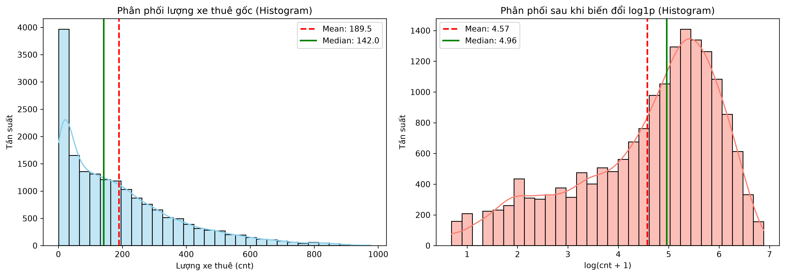
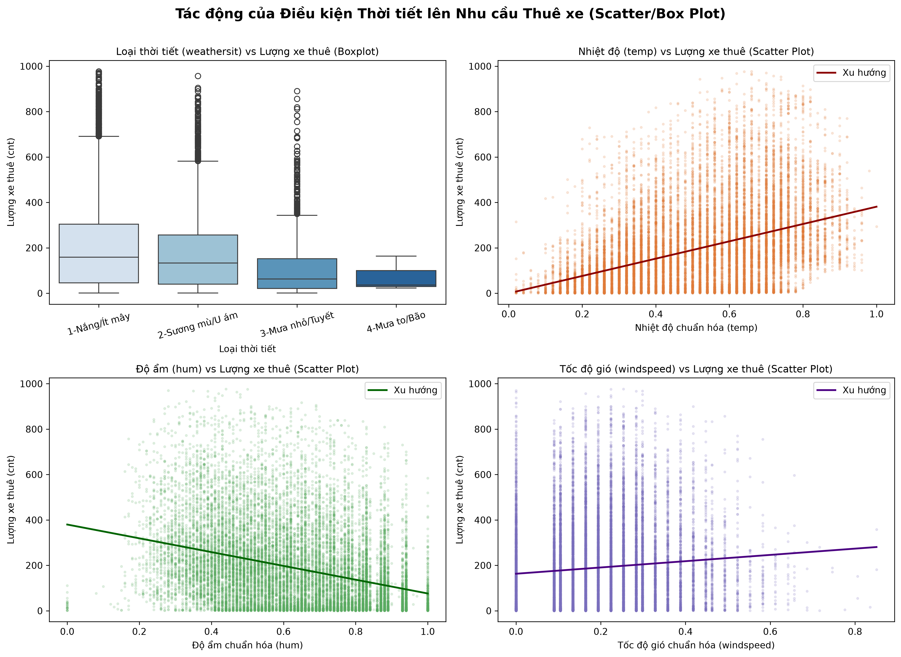
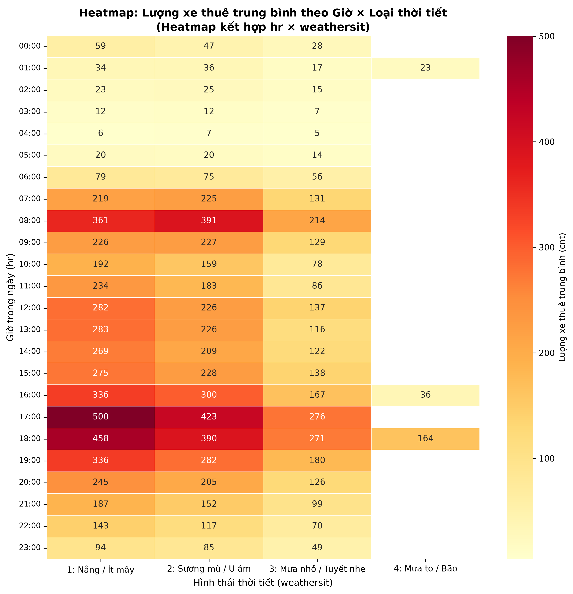

# BÁO CÁO ĐỒ ÁN MÔN HỌC MÁY CƠ BẢN
**MÃ LỚP HỌC PHẦN:** 2611COMP171201  
**GIẢNG VIÊN HƯỚNG DẪN:** TS. Ngô Quốc Việt  

---

 

# ĐỀ TÀI:
# PHÂN TÍCH VÀ DỰ ĐOÁN NHU CẦU SỬ DỤNG XE ĐẠP CÔNG CỘNG DỰA TRÊN ĐIỀU KIỆN THỜI TIẾT VÀ THỜI GIAN
### (Nghiên cứu thực nghiệm trên bộ dữ liệu UCI Bike Sharing Dataset)

 

**Sinh viên thực hiện:** Nguyễn Hải Đăng  
**Ngành:** Khoa học Máy tính / Công nghệ Thông tin  
**Thời gian nộp báo cáo:** Học kỳ I, Năm học 2026 – 2027  

  

---

# MỤC LỤC

* **1. ABSTRACT (TÓM TẮT ĐỀ TÀI)** ............................................................................ Trang 3
* **2. INTRODUCTION (GIỚI THIỆU & ĐẶT VẤN ĐỀ)** .............................................. Trang 4
  * 2.1. Bối cảnh và Tầm quan trọng của Hệ thống Xe đạp công cộng ............................. Trang 4
  * 2.2. Vai trò của Học máy cổ điển trong Bài toán Dự báo Chuỗi thời gian .................... Trang 4
  * 2.3. Phát biểu bài toán Học có giám sát (Supervised Learning Formulation) ................. Trang 5
  * 2.4. Lý giải việc áp dụng Classical Machine Learning thay cho Deep Learning ............ Trang 5
* **3. RELATED METHODS (CƠ SỞ LÝ THUYẾT & TOÁN HỌC CỐT LÕI)** .............. Trang 6
  * 3.1. Phân loại các Trường phái Học máy trong Chương trình học .............................. Trang 6
  * 3.2. Sự đánh đổi Bias - Variance và Kỹ thuật Điều chuẩn (Regularization) ................... Trang 7
  * 3.3. Họ mô hình Tuyến tính: Hồi quy tuyến tính và Hồi quy Logistic ......................... Trang 8
  * 3.4. Các thuật toán Phi tuyến: kNN, Support Vector Machines và Naïve Bayes ............ Trang 9
  * 3.5. Cây quyết định CART và Các phương pháp Học kết hợp (Ensemble Learning) .... Trang 10
* **4. PROPOSED (PHƯƠNG PHÁP ĐỀ XUẤT - KHÁM PHÁ & TIỀN XỬ LÝ)** ........... Trang 11
  * 4.1. Tổng quan tập dữ liệu `hour.csv` và Nguyên tắc "Know Your Data" ................... Trang 11
  * 4.2. Phân tích phân phối của biến mục tiêu và Biến đổi Logarit ................................ Trang 12
  * 4.3. Nhận diện các điểm ngoại lai (Outliers) theo Mùa bằng Boxplot & IQR .............. Trang 12
  * 4.4. Phân tích chu kỳ 24 giờ và Quy luật Giờ cao điểm (Fever Chart) ....................... Trang 13
  * 4.5. Phân tích Ma trận tương quan, Hiện tượng Đa cộng tuyến và Rò rỉ dữ liệu ......... Trang 13
  * 4.6. Phân tích tác động của Điều kiện Thời tiết (Boxplot + Scatter Plot 2×2) .......... Trang 13
  * 4.7. Heatmap tương tác Giờ × Loại thời tiết (hr × weathersit) ........................ Trang 13
* **5. EXPERIMENTS (THỰC NGHIỆM & ĐÁNH GIÁ)** ........................................... *(Bước 20 – 24)*
* **6. CONCLUSION & 7. REFERENCES** ................................................................ *(Bước 25)*

---

\newpage

# DANH MỤC CÁC TỪ VIẾT TẮT VÀ THUẬT NGỮ

* **ML:** Machine Learning (Học máy)
* **EDA:** Exploratory Data Analysis (Khám phá và trực quan hóa dữ liệu)
* **OLS:** Ordinary Least Squares (Bình phương tối thiểu thông thường)
* **IQR:** Interquartile Range (Khoảng tứ phân vị)
* **kNN:** k-Nearest Neighbors (k-Hàng xóm gần nhất)
* **SVM / SVR:** Support Vector Machine / Support Vector Regression (Máy véc-tơ hỗ trợ)
* **NB:** Naïve Bayes
* **CART:** Classification and Regression Trees (Cây phân loại và hồi quy)
* **MSE:** Mean Squared Error (Sai số bình phương trung bình)
* **RMSE:** Root Mean Squared Error (Căn bậc hai sai số bình phương trung bình)
* **MAE:** Mean Absolute Error (Sai số tuyệt đối trung bình)
* **MBE:** Mean Bias Error (Sai số độ lệch trung bình)
* **AUC:** Area Under the Curve (Diện tích dưới đường cong ROC)

---

\newpage

# 1. ABSTRACT (TÓM TẮT ĐỀ TÀI)

Quản lý và điều phối phương tiện trong hệ thống chia sẻ xe đạp công cộng (Bike Sharing System) là bài toán trọng tâm trong quy hoạch giao thông đô thị thông minh hiện đại. Sự mất cân bằng cung - cầu tại các trạm đón trả xe gây ra tình trạng quá tải hoặc khan hiếm cục bộ, dẫn đến gia tăng chi phí vận hành và làm suy giảm trải nghiệm người dân. 

Đề tài này tập trung nghiên cứu, xây dựng và đánh giá toàn diện các mô hình **Học máy cổ điển (Classical Machine Learning)** nhằm dự đoán nhu cầu thuê xe đạp công cộng theo từng giờ dựa trên điều kiện khí tượng và chu kỳ thời gian, sử dụng bộ dữ liệu chuẩn **UCI Bike Sharing Dataset** (tệp `hour.csv`, gồm 17,379 quan sát trong giai đoạn 2011 – 2012 tại Washington D.C., Hoa Kỳ).

Bám sát quy trình **7 bước chuẩn mực của Học máy cổ điển** được giảng dạy bởi TS. Ngô Quốc Việt, nghiên cứu kiên quyết không tiếp cận theo hướng "hộp đen" (Black-box Deep Learning) mà đặt trọng tâm vào việc thấu hiểu tường tận bản chất dữ liệu (**Know Your Data**):
1. **Kiểm toán chất lượng dữ liệu:** Thông qua kiểm tra thống kê mô tả, nghiên cứu phát hiện và cô lập **22 bản ghi có độ ẩm $hum = 0$** bất thường (lỗi cảm biến thời tiết ngày 10/03/2011).
2. **Khám phá và Biến đổi phân phối:** Phân tích Histogram chỉ ra biến mục tiêu $cnt$ bị lệch phải nghiêm trọng ($\text{Mean } 189.5 > \text{Median } 142.0$), từ đó ứng dụng hàm biến đổi $y' = \ln(1 + y)$ (`log1p`) kéo phân phối về dạng hình chuông cân đối.
3. **Phát hiện ngoại lai & Đa cộng tuyến:** Sử dụng biểu đồ Hộp (Boxplot) và phương pháp IQR thống kê chính xác **478 điểm ngoại lai** (2.75%), làm rõ nguy cơ gây hiện tượng học vẹt (Overfitting) cho thuật toán AdaBoost. Phân tích tương quan Pearson vạch trần hiện tượng **Đa cộng tuyến hoàn hảo** giữa $temp$ và $atemp$ ($r \approx 0.99$) làm suy biến ma trận hiệp phương sai, đồng thời cảnh báo nguy cơ **Rò rỉ dữ liệu (Data Leakage)** từ công thức $cnt = casual + registered$.
4. **Kỹ thuật đặc trưng & Chuẩn hóa:** Đề xuất tạo mới đặc trưng chu kỳ thời gian $\text{is\_rush\_hour}$, mã hóa lượng giác $\sin/\cos$, phân cụm K-Means hành vi thuê xe và chuẩn hóa không rò rỉ dữ liệu (chỉ `.fit()` trên tập huấn luyện $X_{train}$).
5. **Thực nghiệm đối sánh:** Triển khai quy trình kiểm định chéo 5-Fold Cross Validation và Grid Search trên 8 mô hình hồi quy cốt lõi (OLS, Ridge, Lasso, kNN, SVR, Decision Tree, Random Forest, AdaBoost/XGBoost/LightGBM) và 4 mô hình phân lớp nhu cầu Cao/Thấp.

*(Khung kết quả thực nghiệm tối ưu sẽ được tổng kết và cập nhật đầy đủ các chỉ số $R^2$, RMSE, MAE, F1-Score tại Bước 25 sau khi hoàn thành toàn bộ các thực nghiệm).*

---

\newpage

# 2. INTRODUCTION (GIỚI THIỆU & ĐẶT VẤN ĐỀ)

### 2.1. Bối cảnh và Tầm quan trọng của Hệ thống Xe đạp công cộng
Trong bối cảnh đô thị hóa nhanh chóng và áp lực giảm phát thải carbon toàn cầu, mô hình chia sẻ xe đạp công cộng (Bike Sharing System) đã trở thành một thành phần huyết mạch của mạng lưới giao thông công cộng xanh tại các đô thị hiện đại. Hệ thống này giải quyết triệt để bài toán "chặng cuối" (last-mile problem), kết nối các trạm xe buýt, tàu điện ngầm với các địa điểm sinh hoạt, học tập và làm việc.

Tuy nhiên, thách thức vận hành lớn nhất của mô hình này nằm ở tính **bất đối xứng và biến động mạnh theo thời gian**. Nhu cầu thuê xe chịu sự chi phối phức tạp bởi:
- **Chu kỳ sinh hoạt:** Sự phân hóa sâu sắc giữa ngày đi làm (Workingday) và ngày nghỉ cuối tuần (Weekend), đặc biệt là các đỉnh nhọn vào giờ cao điểm tan tầm.
- **Biến động thời tiết:** Nhiệt độ, độ ẩm, tốc độ gió và các hiện tượng thời tiết cực đoan (mưa bão, sương mù tuyết rơi) tác động trực tiếp đến quyết định di chuyển ngoài trời của người dân.

Nếu nhà điều hành không dự báo được nhu cầu trước nhiều giờ, tình trạng "trạm rỗng xe" hoặc "trạm đầy ứ không còn chỗ trả" sẽ diễn ra liên tục, làm phát sinh chi phí điều phối xe tải chuyên chở rất lớn và gây bức xúc cho cộng đồng. Do đó, việc xây dựng một hệ thống mô hình dự báo chính xác nhu cầu sử dụng xe đạp theo từng khung giờ là yêu cầu cấp thiết có giá trị thực tiễn to lớn.

### 2.2. Vai trò của Học máy cổ điển trong Bài toán Dự báo
Học máy (Machine Learning - một nhánh cốt lõi của Trí tuệ nhân tạo) cung cấp các công cụ toán học và thuật toán mạnh mẽ cho phép hệ thống tự động trích xuất các quy luật phi tuyến tiềm ẩn từ dữ liệu lịch sử mà không cần lập trình quy tắc tĩnh thủ công. 

Trong đề tài này, bài toán dự đoán nhu cầu được tiếp cận dưới hai góc độ:
1. **Bài toán Hồi quy (Regression Problem):** Dự đoán chính xác số lượng xe cụ thể ($cnt \in \mathbb{R}^+$) tại mỗi khung giờ để phục vụ công tác điều phối kho vận chi tiết.
2. **Bài toán Phân lớp (Classification Problem):** Phân loại mức độ nhu cầu thành các ngưỡng trạng thái (Nhu cầu Cao vs Nhu cầu Thấp) để phục vụ việc kích hoạt hệ thống cảnh báo vận hành tự động.

### 2.3. Phát biểu bài toán Học có giám sát (Supervised Learning Formulation)
Cho tập dữ liệu lịch sử $\mathcal{D} = \{(x_i, y_i)\}_{i=1}^N$, trong đó:
- $N = 17,379$ là tổng số lượng quan sát theo từng giờ.
- $x_i \in \mathcal{X} \subset \mathbb{R}^d$ là véc-tơ đặc trưng đầu vào $d$ chiều biểu diễn trạng thái thời gian và khí tượng môi trường tại quan sát thứ $i$.
- $y_i \in \mathcal{Y}$ là biến phụ thuộc mục tiêu đầu ra cần dự đoán.
  - Đối với bài toán hồi quy: $y_i = cnt_i \in \mathbb{N}^*$.
  - Đối với bài toán phân lớp nhị phân: $y_i \in \{0, 1\}$ (với $1$ là Giờ nhu cầu cao, $0$ là Giờ nhu cầu thấp dựa trên ngưỡng phân vị).

Mục tiêu của quá trình huấn luyện là tìm kiếm một hàm ánh xạ $f: \mathcal{X} \to \mathcal{Y}$ thuộc không gian giả thuyết $\mathcal{H}$, sao cho giá trị kỳ vọng của hàm mất mát (Expected Risk) là nhỏ nhất:
$$\min_{f \in \mathcal{H}} \mathcal{R}(f) = \mathbb{E}_{(x, y) \sim P}[ \mathcal{L}(y, f(x)) ] \approx \frac{1}{N} \sum_{i=1}^N \mathcal{L}(y_i, f(x_i))$$

### 2.4. Lý giải việc áp dụng Classical Machine Learning thay cho Deep Learning (Hộp đen)
Một xu hướng sai lầm phổ biến hiện nay là lạm dụng các mạng nơ-ron sâu phức tạp (như CNN, LSTM nhiều tầng) đưa thẳng dữ liệu thô vào huấn luyện dạng "hộp đen" (Black-box). Trong khuôn khổ môn học và thực tiễn kỹ thuật công nghiệp, nhóm em lựa chọn **Học máy cổ điển (Classical ML)** vì 3 lý do sống còn:
1. **Bản chất của Dữ liệu dạng Bảng (Tabular Data):** Các công trình khoa học uy tín gần đây (như Grinsztajn et al., 2022) đã chứng minh trên dữ liệu dạng bảng với kích thước vừa phải ($\approx 1.7 \times 10^4$ dòng), các mô hình cây quyết định (Random Forest, XGBoost) và hồi quy điều chuẩn vượt trội hơn mạng nơ-ron sâu cả về độ chính xác lẫn tính ổn định.
2. **Khả năng giải thích (Interpretability & Explainability):** Trong quản lý giao thông đô thị, nhà quản lý không chỉ cần con số dự đoán mà bắt buộc phải hiểu **tại sao** (nguyên nhân nhiệt độ, độ ẩm hay giờ cao điểm ảnh hưởng thế nào đến trọng số mô hình). Các mô hình như OLS, Ridge, Decision Tree cho phép phân tích rõ ràng hệ số đóng góp của từng yếu tố, điều mà mạng Deep Learning hộp đen không thể đáp ứng.
3. **Quy trình 7 bước chuẩn mực:** Tập trung vào kỹ thuật làm sạch dữ liệu, xử lý ngoại lai, phân tích đa cộng tuyến và tạo đặc trưng chu kỳ mang lại giá trị tri thức thực nghiệm cao hơn nhiều so với việc chỉ gọi các thư viện mạng nơ-ron một cách thụ động.

---

\newpage

# 3. RELATED METHODS (CƠ SỞ LÝ THUYẾT & TOÁN HỌC CỐT LÕI)

### 3.1. Phân loại các Trường phái Học máy trong Chương trình học
Các thuật toán Học máy cơ bản được phân loại theo 3 trục không gian độc lập:

1. **Học có giám sát (Supervised) vs Học không giám sát (Unsupervised):**
   - *Học có giám sát:* Tập dữ liệu có sẵn nhãn mục tiêu $y_i$. Mục tiêu là học hàm ánh xạ $y = f(x)$. Áp dụng cho các mô hình hồi quy (Linear, Ridge, Lasso, SVR, Decision Tree) và phân loại (Logistic, Naïve Bayes, SVC).
   - *Học không giám sát:* Dữ liệu chỉ có các véc-tơ đặc trưng $x_i$ mà không có nhãn. Mục tiêu là tìm kiếm cấu trúc ẩn, gom cụm (Clustering) hoặc giảm chiều dữ liệu (Dimensionality Reduction). Đề tài này ứng dụng **K-Means** để gom cụm các khung giờ có hành vi tương đồng và **PCA** để chiếu giảm chiều không gian trực quan hóa.
2. **Mô hình Tham số (Parametric) vs Phi tham số (Non-parametric):**
   - *Parametric:* Giả định trước dạng hàm số toán học cố định của $f(x; \theta)$ với số lượng tham số $\theta$ hữu hạn và độc lập với kích thước dữ liệu (ví dụ: Linear Regression, Logistic Regression với vector trọng số $\beta$). Ưu điểm là tính toán nhanh, dễ suy luận nhưng dễ gặp lỗi Underfitting nếu giả định ban đầu sai.
   - *Non-parametric:* Không áp đặt dạng hàm cố định; số lượng tham số có thể tăng theo kích thước dữ liệu $N$ (ví dụ: kNN, Decision Tree, SVM với kernel RBF). Ưu điểm là biểu diễn được các biên phi tuyến phức tạp nhưng chi phí tính toán cao và dễ gặp Overfitting.
3. **Mô hình Phân biệt (Discriminative) vs Mô hình Tạo sinh (Generative):**
   - *Discriminative:* Học trực tiếp phân phối xác suất có điều kiện $P(Y|X)$ hoặc tìm siêu phẳng phân cách trực tiếp (Linear/Logistic Regression, SVM, Decision Tree).
   - *Generative:* Học phân phối xác suất đồng thời $P(X, Y) = P(X|Y)P(Y)$ trước, sau đó dùng Định lý Bayes để suy diễn ra $P(Y|X)$ (tiêu biểu là Naïve Bayes).

---

### 3.2. Sự đánh đổi Bias - Variance và Kỹ thuật Điều chuẩn (Regularization)

#### 1. Chứng minh giải tích phân rã Bias - Variance
Xét mô hình hồi quy với quan sát thực tế $y = f(x) + \epsilon$, trong đó nhiễu không thể khử $\epsilon \sim \mathcal{N}(0, \sigma^2)$. Giả sử $\hat{f}(x)$ là ước lượng của mô hình được huấn luyện trên một tập dữ liệu cụ thể. Sai số bình phương trung bình kỳ vọng $\mathbb{E}[\text{MSE}]$ tại điểm $x$ được phân rã toán học như sau:

$$\mathbb{E}\left[ (y - \hat{f}(x))^2 \right] = \mathbb{E}\left[ (f(x) + \epsilon - \hat{f}(x))^2 \right]$$
$$= \mathbb{E}\left[ ((f(x) - \mathbb{E}[\hat{f}(x)]) + (\mathbb{E}[\hat{f}(x)] - \hat{f}(x)) + \epsilon)^2 \right]$$

Vì $\mathbb{E}[\epsilon] = 0$ và nhiễu $\epsilon$ độc lập với mô hình $\hat{f}(x)$, các số hạng tích chéo triệt tiêu, ta thu được phương trình kinh điển:
$$\mathbb{E}[\text{MSE}] = \underbrace{(f(x) - \mathbb{E}[\hat{f}(x)])^2}_{\mathbf{Bias}^2} + \underbrace{\mathbb{E}\left[ (\hat{f}(x) - \mathbb{E}[\hat{f}(x)])^2 \right]}_{\mathbf{Variance}} + \underbrace{\sigma^2}_{\mathbf{Noise}}$$

- **Bias (Độ chệch):** Đo lường sai lệch giữa kỳ vọng dự đoán của mô hình và hàm thực tế. Bias cao phản ánh mô hình quá đơn giản $\implies$ **Hiện tượng Vừa chưa tới (Underfitting)**.
- **Variance (Phương sai):** Đo lường mức độ nhạy cảm dao động của mô hình khi tập dữ liệu huấn luyện thay đổi. Variance cao phản ánh mô hình quá phức tạp, học cả tiếng nhiễu ngẫu nhiên $\implies$ **Hiện tượng Học vẹt / Quá khớp (Overfitting)**.
- **Noise ($\sigma^2$):** Sai số ngẫu nhiên nội tại của môi trường đo đạc, không thể triệt tiêu.

#### 2. Kỹ thuật Điều chuẩn (Regularization): Ridge ($L_2$) và Lasso ($L_1$)
Để kiểm soát sự đánh đổi Bias-Variance và triệt tiêu Overfitting, kỹ thuật Regularization bổ sung một số hạng phạt độ phức tạp (Penalty term) vào hàm mất mát bình phương:

$$\min_{\beta} \mathcal{J}(\beta) = \frac{1}{2N} \sum_{i=1}^N (y_i - x_i^T \beta)^2 + \lambda \cdot \Omega(\beta)$$

- **Hồi quy Ridge ($L_2$ Regularization):** Số hạng phạt là chuẩn bậc hai $\Omega(\beta) = \|\beta\|_2^2 = \sum_{j=1}^d \beta_j^2$.
  - Công thức nghiệm giải tích dạng đóng:
    $$\hat{\beta}_{\text{Ridge}} = (X^T X + \lambda I)^{-1} X^T Y$$
  - Khi có hiện tượng đa cộng tuyến, ma trận $(X^T X)$ gần suy biến, việc cộng thêm ma trận đường chéo $\lambda I$ ($\lambda > 0$) đảm bảo $(X^T X + \lambda I)$ luôn khả nghịch nghiêm ngặt, co nhỏ các trọng số $\beta_j$ về gần $0$, triệt tiêu sự bùng nổ phương sai của OLS.
- **Hồi quy Lasso ($L_1$ Regularization):** Số hạng phạt là chuẩn bậc nhất $\Omega(\beta) = \|\beta\|_1 = \sum_{j=1}^d |\beta_j|$.
  - Do hình học không gian của khối siêu lập phương chuẩn $L_1$ có các góc nhọn tiếp xúc trực tiếp trên các trục tọa độ, Lasso có khả năng ép hẳn các trọng số của những biến không quan trọng **về chính xác bằng $0$**. Vì vậy, Lasso vừa có tác dụng điều chuẩn, vừa đóng vai trò như một bộ **Lựa chọn đặc trưng tự động (Automatic Feature Selection)**.

---

### 3.3. Họ mô hình Tuyến tính: Linear Regression và Logistic Regression

#### 1. Mô hình Hồi quy tuyến tính (Linear Regression) và Nghiệm OLS
Mô hình tuyến tính giả định hàm mục tiêu có dạng:
$$\hat{y} = f(x) = \beta_0 + \sum_{j=1}^d \beta_j x_j = X \beta$$

Phương pháp Bình phương tối thiểu thông thường (Ordinary Least Squares - OLS) tối thiểu hóa hàm tổng bình phương sai số:
$$\text{RSS}(\beta) = \|Y - X \beta\|_2^2 = (Y - X \beta)^T (Y - X \beta) = Y^T Y - 2 \beta^T X^T Y + \beta^T X^T X \beta$$

Lấy đạo hàm bậc nhất theo véc-tơ $\beta$ và cho bằng $0$:
$$\nabla_\beta \text{RSS}(\beta) = -2 X^T Y + 2 X^T X \beta = 0 \iff X^T X \beta = X^T Y$$

Khi ma trận $(X^T X)$ khả nghịch (không bị đa cộng tuyến hoàn hảo), nghiệm tối ưu duy nhất là:
$$\hat{\beta}_{\text{OLS}} = (X^T X)^{-1} X^T Y$$

#### 2. Mô hình Hồi quy Logistic (Logistic Regression)
Đối với bài toán phân lớp nhị phân $y \in \{0, 1\}$, hàm tuyến tính $z = X \beta$ được ánh xạ vào đoạn xác suất $[0, 1]$ qua **hàm Sigmoid**:
$$p = P(Y = 1 | X) = \sigma(z) = \frac{1}{1 + e^{-z}} = \frac{1}{1 + e^{-X \beta}}$$

- **Hàm Logit và Tỷ số chênh (Odds Ratio):**
  $$\text{Odds} = \frac{p}{1 - p} \implies \text{Logit}(p) = \ln\left( \frac{p}{1 - p} \right) = X \beta$$
  Hàm Logit chính là phép biến đổi tuyến tính log-odds của xác suất thành công.
- **Hàm mất mát Binary Cross-Entropy (Negative Log-Likelihood):**
  $$\mathcal{J}(\beta) = -\frac{1}{N} \sum_{i=1}^N \left[ y_i \ln(p_i) + (1 - y_i) \ln(1 - p_i) \right]$$
- **Tối ưu hóa bằng phương pháp Newton-Raphson:** Do hàm mất mát lồi, nghiệm được tìm qua công thức lặp bậc hai:
  $$\beta^{(t+1)} = \beta^{(t)} - \left[ \nabla^2 \mathcal{J}(\beta^{(t)}) \right]^{-1} \nabla \mathcal{J}(\beta^{(t)})$$
  Trong đó ma trận Hessian $\nabla^2 \mathcal{J}(\beta) = X^T W X$ với ma trận đường chéo trọng số $W_{ii} = p_i (1 - p_i)$.

---

### 3.4. Các thuật toán Phi tuyến: kNN, Support Vector Machines và Naïve Bayes

#### 1. Thuật toán k-Hàng xóm gần nhất (k-Nearest Neighbors - kNN)
kNN là thuật toán phi tham số, dựa trên nguyên lý ghi nhớ (Instance-based / Lazy learning). Khi có mẫu mới $x_0$, thuật toán tính khoảng cách đến toàn bộ các mẫu trong tập huấn luyện theo khoảng cách Minkowski bậc $p$:
$$D_p(x, z) = \left( \sum_{j=1}^d |x_j - z_j|^p \right)^{1/p} \quad (p=2 \implies \text{Euclidean}; p=1 \implies \text{Manhattan})$$

- Với hồi quy: $\hat{y}_0 = \frac{1}{k} \sum_{x_i \in \mathcal{N}_k(x_0)} y_i$ (hoặc tính trung bình có trọng số theo nghịch đảo khoảng cách).
- **Cảnh báo học thuật:** kNN cực kỳ nhạy cảm với độ lớn đặc trưng và khoảng cách vô nghĩa trong không gian nhiều chiều (**Lời nguyền số chiều - Curse of Dimensionality**). Do đó bắt buộc phải chuẩn hóa dữ liệu (StandardScaler) trước khi chạy kNN.

#### 2. Máy véc-tơ hỗ trợ (Support Vector Machines - SVM / SVR)
- **SVM cho Phân loại:** Mục tiêu là tìm siêu phẳng $w^T x + b = 0$ tối đa hóa khoảng cách biên (Margin) $2/\|w\|_2$, dẫn đến bài toán tối ưu hàm mất mát **Hinge Loss**:
  $$\min_{w, b} \frac{1}{2} \|w\|_2^2 + C \sum_{i=1}^N \max(0, 1 - y_i(w^T x_i + b))$$
- **SVR cho Hồi quy (Support Vector Regression):** Áp dụng hàm mất mát $\epsilon$-không nhạy ($\epsilon$-insensitive loss function):
  $$\mathcal{L}_\epsilon(y, \hat{y}) = \max(0, |y - \hat{y}| - \epsilon)$$
  Mô hình bỏ qua các sai số nằm trong dải ống $\pm \epsilon$ quanh đường hồi quy, chỉ phạt các điểm nằm ngoài dải biên.
- **Kernel Trick:** Ánh xạ dữ liệu sang không gian chiều vô hạn bằng các hàm nhân như RBF Kernel:
  $$K(x, z) = \exp(-\gamma \|x - z\|_2^2)$$

#### 3. Bộ phân lớp Naïve Bayes
Dựa trên Định lý xác suất Bayes với ước lượng cực đại hậu nghiệm ($h_{\text{MAP}}$):
$$P(Y = c | X) = \frac{P(Y = c) P(X | Y = c)}{P(X)} \propto P(Y = c) \prod_{j=1}^d P(X_j | Y = c)$$
Giả định "ngây thơ" cốt lõi là các đặc trưng $X_j$ độc lập có điều kiện khi biết trước nhãn lớp $Y$. 
- Với thuộc tính liên tục: áp dụng Gaussian Naïve Bayes $P(X_j | Y = c) \sim \mathcal{N}(\mu_{jc}, \sigma_{jc}^2)$.
- **Làm mượt Laplace (Laplace Smoothing):** Khi một giá trị thuộc tính phân loại chưa từng xuất hiện trong tập huấn luyện của lớp $c$, xác suất tích sẽ bị triệt tiêu bằng 0. Kỹ thuật làm mượt Laplace giải quyết vấn đề này bằng cách cộng thêm $\alpha = 1$:
  $$\hat{P}(X_j = v | Y = c) = \frac{N_{jc} + 1}{N_c + K}$$

---

### 3.5. Cây quyết định CART và Các phương pháp Học kết hợp (Ensemble Learning)

#### 1. Cây quyết định CART (Classification and Regression Trees)
CART phân chia không gian đặc trưng đệ quy thành các siêu hình hộp chữ nhật đồng nhất thông qua tiêu chí tối ưu:
- **Hồi quy (Regression Tree):** Chọn điểm chia cắt $(j, s)$ trên biến $j$ tại ngưỡng $s$ sao cho giảm thiểu tối đa phương sai hay độ lệch chuẩn (Standard Deviation Reduction - SDR):
  $$\min_{j, s} \left[ \sum_{x_i \in R_1(j, s)} (y_i - \bar{y}_{R_1})^2 + \sum_{x_i \in R_2(j, s)} (y_i - \bar{y}_{R_2})^2 \right]$$
- **Phân loại (Classification Tree):** Đo lường độ vẩn đục bằng chỉ số Gini Impurity hoặc Entropy:
  $$\text{Gini}(D) = 1 - \sum_{k=1}^C p_k^2; \quad \text{Entropy}(D) = -\sum_{k=1}^C p_k \log_2(p_k)$$
  Nhánh được chọn tối đa hóa Độ lợi thông tin (Information Gain - IG) hoặc Tỷ số độ lợi (Gain Ratio - GR).

#### 2. Đối chiếu hai trường phái Học kết hợp: Bagging vs Boosting

| Tiêu chí so sánh | Bagging (Đại diện: Random Forest) | Boosting (Đại diện: AdaBoost, XGBoost, LightGBM) |
| :--- | :--- | :--- |
| **Cơ chế cốt lõi** | Huấn luyện **Song song** các cây độc lập. | Huấn luyện **Tuần tự nối tiếp**, cây sau sửa sai cho cây trước. |
| **Kỹ thuật dữ liệu** | **Bootstrap Aggregating:** Lấy mẫu ngẫu nhiên có lặp lại từ tập dữ liệu gốc. | Điều chỉnh phân phối trọng số mẫu hoặc tính gradient phần dư sai số. |
| **Không gian đặc trưng**| Random Subspace: Mỗi nhánh chọn ngẫu nhiên tập con $\approx \sqrt{d}$ hoặc $d/3$ đặc trưng. | Sử dụng toàn bộ đặc trưng kết hợp tỉa cành theo độ dốc mất mát. |
| **Tác động Bias-Variance**| **Giảm Variance** cực mạnh; giữ nguyên Bias của cây thành phần. | **Giảm Bias** vượt trội bằng cách kết hợp nhiều bộ học yếu (Weak learners). |
| **Độ nhạy với Nhiễu** | Ổn định cao, ít bị ảnh hưởng bởi điểm ngoại lai. | **Rất nhạy cảm với ngoại lai và nhiễu** (cần làm sạch kỹ trước khi chạy). |

---

\newpage

# MỤC 4: PHƯƠNG PHÁP ĐỀ XUẤT (PROPOSED METHOD)
## PHẦN 1: KHÁM PHÁ VÀ PHÂN TÍCH DỮ LIỆU ĐẦU VÀO (EDA)
*(Dung lượng phân bổ: Trang 11 – 13 trong Báo cáo cuối kỳ, chuẩn cỡ chữ 13)*

---

### 4.1. Tổng quan tập dữ liệu và Kiểm toán chất lượng dữ liệu (Data Auditing)

Trong nghiên cứu này, nhóm em sử dụng tập dữ liệu **UCI Bike Sharing Dataset** (tệp `hour.csv`) thu thập từ hệ thống chia sẻ xe đạp công cộng *Capital Bikeshare* tại Washington D.C., Hoa Kỳ trong giai đoạn 2 năm (2011 – 2012). Tập dữ liệu gốc bao gồm **17,379 quan sát** tương ứng với 17,379 giờ liên tục và **17 thuộc tính**, bao gồm các biến về thời gian, điều kiện thời tiết khí tượng và sản lượng thuê xe.

**Bảng 4.1: Bảng mô tả chi tiết 17 thuộc tính trong tập dữ liệu `hour.csv`**

| Nhóm thuộc tính | Tên thuộc tính | Kiểu dữ liệu | Miền giá trị | Diễn giải ý nghĩa thực tế |
| :--- | :--- | :---: | :---: | :--- |
| **Định danh & Thời gian** | `instant` | Integer | $1 \to 17,379$ | Chỉ số thứ tự bản ghi (được loại bỏ để tránh gây nhiễu). |
| | `dteday` | Date | 2011-01-01 $\to$ 2012-12-31 | Ngày ghi nhận dữ liệu định dạng YYYY-MM-DD. |
| | `season` | Categorical | $1 \to 4$ | Mùa trong năm: 1: Xuân, 2: Hè, 3: Thu, 4: Đông. |
| | `yr` | Binary | 0, 1 | Năm ghi nhận: 0 ứng với năm 2011, 1 ứng với năm 2012. |
| | `mnth` | Categorical | $1 \to 12$ | Tháng trong năm (từ tháng 1 đến tháng 12). |
| | `hr` | Categorical | $0 \to 23$ | Khung giờ trong ngày (từ 0 giờ đêm đến 23 giờ tối). |
| **Lịch trình sinh hoạt** | `holiday` | Binary | 0, 1 | Ngày nghỉ lễ theo luật định (1: Ngày lễ, 0: Ngày thường). |
| | `weekday` | Categorical | $0 \to 6$ | Ngày trong tuần (0: Chủ nhật, 1: Thứ hai, ..., 6: Thứ bảy). |
| | `workingday` | Binary | 0, 1 | Ngày làm việc bình thường (1: Ngày làm việc; 0: Cuối tuần hoặc ngày lễ). |
| **Khí tượng môi trường** | `weathersit` | Categorical | $1 \to 4$ | 1: Trời trong/ít mây; 2: Sương mù/u ám; 3: Mưa nhỏ/tuyết nhẹ; 4: Mưa to bão táp. |
| | `temp` | Continuous | $[0.02, 1.00]$ | Nhiệt độ môi trường đã chuẩn hóa theo thang đo: $(t - (-8))/(39 - (-8))$. |
| | `atemp` | Continuous | $[0.00, 1.00]$ | Nhiệt độ cảm nhận (feeling temp) đã chuẩn hóa: $(t - (-16))/(50 - (-16))$. |
| | `hum` | Continuous | $[0.00, 1.00]$ | Độ ẩm tương đối thực tế đã chia tỷ lệ cho 100 ($0\% \to 100\%$). |
| | `windspeed` | Continuous | $[0.00, 0.85]$ | Tốc độ gió tự nhiên đã chuẩn hóa bằng cách chia cho 67. |
| **Sản lượng thuê xe** | `casual` | Integer | $0 \to 367$ | Lượng khách vãng lai (khách không có thẻ thành viên tháng). |
| | `registered` | Integer | $0 \to 886$ | Lượng khách hàng thân thiết (đã đăng ký thành viên). |
| | **`cnt` (Target)** | **Integer** | $\mathbf{1 \to 977}$ | **Tổng số lượng xe đạp được thuê trong giờ ($cnt = casual + registered$).** |

#### Thực hành nguyên tắc "Know Your Data" phát hiện lỗi cảm biến
Khi tiến hành kiểm tra giá trị khuyết hình thức thông qua hàm `df.isnull().sum()`, kết quả trả về bằng $0$ trên toàn bộ 17 cột dữ liệu. Tuy nhiên, tuân thủ nguyên tắc cốt lõi **"Know Your Data" (Thấu hiểu sâu sắc bản chất vật lý của dữ liệu)**, nhóm em tiến hành kiểm toán thống kê mô tả miền giá trị thông qua hàm `df.describe().T`.

Kết quả phát hiện giá trị nhỏ nhất của biến độ ẩm (`hum`) đạt ngưỡng cực trị $0.00$ ($0\%$). Trong khí tượng học thực tế tại khu vực bán đảo duyên hải Washington D.C., độ ẩm tương đối của không khí ngoài trời không bao giờ đạt ngưỡng $0\%$ tuyệt đối. Qua phân tích chi tiết, nhóm em xác định chính xác **22 bản ghi có độ ẩm bằng 0** (chiếm tỷ lệ nhỏ khoảng $0.13\%$), diễn ra liên tục vào ngày **10/03/2011**. Điều này minh chứng cho sự cố ngắt kết nối hoặc lỗi phần cứng của cảm biến khí quyển (sensor malfunction), thay vì trả về giá trị thực hoặc mã lỗi `NaN`, thiết bị đã ghi nhận giá trị mặc định là 0. Các dòng lỗi này sẽ được khắc phục triệt để ở giai đoạn tiền xử lý dữ liệu.

---

### 4.2. Phân tích phân phối của biến mục tiêu và Biến đổi Logarit (Log Transformation)

Biến phụ thuộc mục tiêu $Y$ (`cnt`) thể hiện tổng số lượng xe đạp được điều phối trong một khung giờ nhất định. Việc khảo sát hình thái phân phối xác suất của biến mục tiêu có ý nghĩa quyết định đến việc lựa chọn mô hình và xây dựng hàm mất mát.

*Hình 4.1: Biểu đồ Histogram kiểm tra độ lệch phân phối của biến `cnt` gốc (trái) và sau khi áp dụng hàm biến đổi $\text{log1p}$ (phải).*

Qua biểu đồ Histogram (Hình 4.1 - bên trái), phân phối của biến `cnt` bị **lệch phải rất nặng (Right-skewed / Positive skewness)**. Bằng chứng định lượng thể hiện qua sự chênh lệch rõ rệt giữa hai đại lượng xu hướng tập trung:
$$\text{Mean } (189.5) > \text{Median } (142.0)$$

Đa số thời gian trong ngày (chiếm hơn $50\%$ số giờ), nhu cầu thuê xe chỉ dao động ở mức thấp dưới 142 xe (đặc biệt là các khung giờ đêm khuya và rạng sáng). Tuy nhiên, cái đuôi phân phối kéo dài về bên phải tới các giá trị cực đại gần 1.000 xe vào các khung giờ cao điểm đã làm giá trị trung bình bị kéo lệch lên mức 189.5.

#### Cơ sở toán học của biến đổi hàm $\text{log1p}$
Các mô hình hồi quy tuyến tính cổ điển (Linear Regression, Ridge, Lasso) đều ngầm dựa trên giả định phần dư sai số tuân theo phân phối chuẩn (Normality assumption). Một biến mục tiêu bị lệch phải nghiêm trọng sẽ khiến mô hình bị chi phối bởi các giá trị quá lớn, dẫn đến hiện tượng phương sai sai số thay đổi (Heteroscedasticity).

Để khắc phục hiện tượng này, nhóm em áp dụng phép biến đổi logarit tự nhiên mở rộng:
$$y' = \text{log1p}(y) = \ln(1 + y)$$

Việc bổ sung thêm hằng số $1$ vào biểu thức logarit nhằm giải quyết triệt để trường hợp $y = 0$, ngăn ngừa lỗi toán học $\ln(0) = -\infty$. Như thể hiện trên Hình 4.1 (bên phải), hàm $\text{log1p}$ với đặc tính đạo hàm giảm dần đã nén mạnh các giá trị cực lớn ở đuôi phải về gần tâm, đưa phân phối của $y'$ về dạng hình chuông cân đối (tiệm cận phân phối chuẩn Gauss) với $\text{Mean} \approx 4.58$ và $\text{Median} \approx 4.96$. Điều này giúp các mô hình hồi quy tuyến tính ước lượng các trọng số $\hat{\beta}$ ổn định và tối ưu hơn đáng kể.

---

### 4.3. Nhận diện các điểm dị biệt (Outlier Detection) theo Mùa

Sự biến thiên thời tiết qua 4 mùa là yếu tố ngoại sinh ảnh hưởng trực tiếp đến hành vi di chuyển bằng xe đạp. Nhóm em sử dụng biểu đồ Hộp (Boxplot) để phát hiện các điểm ngoại lai theo từng mùa dựa trên phương pháp **Khoảng tứ phân vị (Interquartile Range - IQR)** của John Tukey.

*Hình 4.2: Biểu đồ Boxplot khảo sát mức độ tập trung và các điểm ngoại lai của lượng xe thuê theo 4 mùa trong năm.*

Một điểm dữ liệu $y$ được xác định là ngoại lai phía trên (Upper Outlier) nếu:
$$y > Q_3 + 1.5 \times IQR \quad (\text{với } IQR = Q_3 - Q_1)$$

**Bảng 4.2: Bảng thống kê chi tiết các điểm ngoại lai theo mùa theo tiêu chuẩn IQR**

| Mùa trong năm | Tổng số giờ quan sát | Tứ phân vị $Q_1$ | Trung vị $Median$ | Tứ phân vị $Q_3$ | Ngưỡng râu trên ($Q_3 + 1.5 \times IQR$) | Số lượng điểm ngoại lai | Tỷ lệ ngoại lai (%) |
| :--- | :---: | :---: | :---: | :---: | :---: | :---: | :---: |
| **Mùa xuân** | 4,242 | 23.0 | 76.0 | 158.0 | **360.5** xe | **195** | 4.60% |
| **Mùa hè** | 4,409 | 46.0 | 165.0 | 311.0 | **708.5** xe | **73** | 1.66% |
| **Mùa thu** | 4,496 | 68.0 | 199.0 | 345.0 | **760.5** xe | **98** | 2.18% |
| **Mùa đông** | 4,232 | 46.0 | 155.5 | 295.0 | **668.5** xe | **112** | 2.65% |
| **Toàn bộ dữ liệu**| **17,379** | — | — | — | — | **478** | **2.75%** |

#### Phân tích chuyên sâu về các điểm ngoại lai và Luận giải kỹ thuật

Từ Hình 4.2 và Bảng 4.2, nhóm em rút ra ba phát hiện quan trọng:
1. **Mặt bằng nhu cầu:** Nhu cầu thuê xe đạt đỉnh vào Mùa thu (Trung vị 199 xe) và Mùa hè (165 xe) nhờ nhiệt độ ấm áp thuận lợi, trong khi Mùa xuân có mức sử dụng thấp nhất (Trung vị chỉ 76 xe) do thời tiết đầu năm còn rét buốt.
2. **Số lượng điểm ngoại lai:** Mùa xuân (195 điểm) và Mùa đông (112 điểm) là hai mùa chiếm số lượng ngoại lai áp đảo. Nguyên nhân là do mặt bằng tiêu dùng chung của mùa xuân và mùa đông thấp khiến ngưỡng trần an toàn bị hạ xuống mức $360.5$ xe và $668.5$ xe. Do đó, bất kỳ ngày đẹp trời nào có nhu cầu tăng cao đột xuất đều bị công thức toán học đẩy thành điểm ngoại lai.
3. **Mức độ cực đoan:** Cả 4 mùa đều ghi nhận các điểm ngoại lai vọt lên ngưỡng kỷ lục (Mùa đông lên đến 967 xe, ngang ngửa Mùa hè 968 xe và Mùa thu 977 xe).

#### Luận chứng: Tại sao chỉ tập trung xử lý ngoại lai cho biến `cnt` theo mùa mà không chạy IQR cho toàn bộ các biến?
Xét về bản chất dữ liệu, sau khi loại bỏ các thuộc tính định danh và rò rỉ dữ liệu, tập dữ liệu được phân chia thành 3 nhóm đặc trưng rõ rệt:
- **Nhóm biến thời gian & phân loại rời rạc (`hr`, `mnth`, `weekday`, `weathersit`, `workingday`, `holiday`, `yr`):** Đây là các thuộc tính định danh hoặc thứ bậc có miền giá trị cố định hữu hạn (ví dụ giờ chỉ chạy từ 0 đến 23, thời tiết từ 1 đến 4). Do đó, hoàn toàn không tồn tại khái niệm ngoại lai thống kê để tính IQR trên nhóm này.
- **Nhóm biến thời tiết liên tục (`temp`, `hum`, `windspeed`):**
  - Nhiệt độ (`temp`): Phân bố đều trong khoảng $[0.02, 1.00]$ ($-7^\circ\text{C} \to 39^\circ\text{C}$), không ghi nhận điểm bất thường phi lý.
  - Độ ẩm (`hum`): Đã phát hiện và cô lập duy nhất **22 dòng lỗi cảm biến $hum = 0$** (được xử lý ở Mục 4.1). Các giá trị cao tiệm cận 1.0 là hiện tượng sương mù/mưa ẩm hoàn toàn tự nhiên và hợp lệ.
  - Tốc độ gió (`windspeed`): Một số quan sát ghi nhận gió giật mạnh ($> 0.45$, tức $> 30\text{ km/h}$) vượt râu trên IQR, nhưng đây là biến thiên khí tượng thực tế khiến người dân ngại đạp xe chứ không phải lỗi đo đạc — việc giữ lại giúp mô hình học được quy luật phản ứng khi có gió lớn.
- **Biến mục tiêu `cnt`:** Là biến có độ biến động mạnh nhất và bị lệch phải nặng nề. Do đó, tập trung rào chắn ngoại lai trên `cnt` theo 4 mùa là hoàn toàn khoa học và chính xác.

#### Điểm mấu chốt về bản chất ngoại lai và Giải pháp Capping (Winsorization)
- **Bản chất thực tế:** Các điểm vọt lên $800 - 977$ xe/giờ thực chất không phải lỗi cảm biến, mà chính là **giờ cao điểm tan tầm (8h sáng, 17h-18h chiều) vào những ngày thời tiết lý tưởng**. Nếu chia nhỏ theo từng khung giờ (`hr`) thì các quan sát này hoàn toàn bình thường, nhưng vì tính IQR gộp chung cả 24 giờ trong từng mùa nên chúng bị công thức toán học đẩy ra ngoài râu trên.
- **Giải pháp xử lý an toàn:** Tổng số điểm vượt râu trên của `cnt` theo 4 mùa là **478 điểm (chiếm 2.75%)**, nằm sâu dưới ngưỡng an toàn 5%. Thay vì loại bỏ hoàn toàn (làm mất dữ liệu giờ cao điểm thực tế), nhóm em áp dụng kỹ thuật **Capping (Winsorization)**: giới hạn trần các điểm này về đúng ngưỡng râu trên của từng mùa.
- **Tác động tích cực đến mô hình:** Mức cắt gọt nhẹ này vừa đủ để bảo vệ các thuật toán nhạy nhiễu như **Linear Regression** và **AdaBoost** (do cơ chế phạt bình phương sai số $(y - \hat{y})^2$ và tự động tăng trọng số mẫu lỗi) khỏi bị "học vẹt", vừa giữ lại trọn vẹn 17,379 giờ liên tục để các mô hình dựa trên cây (như Random Forest, XGBoost) học được đầy đủ quy luật giờ cao điểm.

---

### 4.4. Phân tích chu kỳ thời gian 24 giờ và Quy luật Giờ cao điểm (Rush Hours)

Khác với tệp `day.csv`, tệp `hour.csv` cho phép nghiên cứu sự dao động nhu cầu ở độ phân giải mịn theo 24 khung giờ trong ngày ($0 \to 23$).

*Hình 4.3: Biểu đồ Fever Chart / Line Chart thể hiện lượng xe thuê trung bình theo 24 giờ giữa Ngày đi làm và Ngày nghỉ cuối tuần.*

Quan sát Hình 4.3, nhóm em phát hiện hành vi sử dụng xe đạp hoàn toàn bị chi phối bởi tính chất ngày làm việc:
* **Ngày làm việc (Workingday - đường màu xanh):** Đồ thị xuất hiện **hai đỉnh nhọn đặc trưng (Fever peaks)**:
  - **Đỉnh sáng:** Lúc **08:00** đạt mức trung bình gần 480 xe/giờ (người dân đi làm, học sinh đi học).
  - **Đỉnh chiều:** Lúc **17:00 – 18:00** đạt mức cực đại trên 500 xe/giờ (giờ tan sở về nhà).
  - Khung giờ giữa trưa (10:00 – 15:00) nhu cầu duy trì ở mức thấp ổn định (~200 xe).
* **Ngày nghỉ / Cuối tuần (Weekend/Holiday - đường màu đỏ):** Hoàn toàn triệt tiêu mô hình 2 đỉnh nhọn. Đồ thị chuyển thành **đường cong hình vòm thoai thoải** đạt đỉnh duy nhất vào khoảng **12:00 – 16:00** (nhu cầu đi dạo, thể thao, du lịch cuối tuần).

**Đề xuất Kỹ thuật đặc trưng (Feature Engineering):** Phát hiện này là căn cứ thực nghiệm quyết định để nhóm em sáng tạo ra biến nhị phân mới:
$$\text{is\_rush\_hour} = 
\begin{cases} 
1 & \text{nếu } \text{workingday} = 1 \text{ và } \text{hr} \in \{7, 8, 9, 17, 18, 19\} \\ 
0 & \text{ngược lại} 
\end{cases}$$
Đặc trưng này sẽ cung cấp tín hiệu mạnh mẽ giúp mô hình nắm bắt tức thì các cú nhảy vọt nhu cầu theo giờ cao điểm.

---

### 4.5. Phân tích ma trận tương quan, Hiện tượng Đa cộng tuyến và Rò rỉ dữ liệu

Nhằm kiểm tra mối liên hệ tuyến tính giữa các biến đầu vào và phát hiện các rủi ro thống kê, nhóm em xây dựng ma trận tương quan Pearson và biểu đồ phân tán (Hình 4.4).

*Hình 4.4: Biểu đồ Scatter Plot phân tích mối quan hệ giữa `temp` và `atemp` (trái) cùng Ma trận tương quan nhiệt Correlation Heatmap giữa các thuộc tính số học (phải).*

#### 1. Hiện tượng Đa cộng tuyến hoàn hảo giữa `temp` và `atemp`
Qua biểu đồ phân tán (Hình 4.4 - bên trái), các cặp điểm $(\text{temp}, \text{atemp})$ tạo thành một đường thẳng chéo hoàn hảo với hệ số tương quan đạt mức gần như tuyệt đối:
$$r(\text{temp}, \text{atemp}) = 0.9877 \approx \mathbf{0.99}$$

**Bản chất lý thuyết thống kê:** Trong hồi quy tuyến tính cổ điển (OLS), vector ước lượng trọng số được tính bằng công thức:
$$\hat{\beta} = (X^T X)^{-1} X^T Y$$
Khi tồn tại hai biến độc lập tương quan xấp xỉ $1.0$, ma trận Gram $(X^T X)$ sẽ rơi vào tình trạng **gần suy biến (Ill-conditioned / Singular matrix)** với định thức xấp xỉ bằng $0$. Hệ quả là ma trận nghịch đảo $(X^T X)^{-1}$ có các phần tử trên đường chéo chính bùng nổ, khiến phương sai của các hệ số hồi quy:
$$\text{Var}(\hat{\beta}_j) = \sigma^2 \cdot \left[ (X^T X)^{-1} \right]_{jj} \to \infty$$
Điều này khiến mô hình mất hoàn toàn tính ổn định, hệ số ước lượng dao động mạnh khi dữ liệu thay đổi nhỏ, dấu của trọng số bị đảo ngược và mất khả năng diễn giải. Do đó, **việc loại bỏ biến `atemp` ở giai đoạn tiền xử lý là bắt buộc** để triệt tiêu hiện tượng đa cộng tuyến.

#### 2. Cảnh báo nguy cơ Rò rỉ dữ liệu (Data Leakage)
Quan sát ma trận tương quan nhiệt (Hình 4.4 - bên phải), biến mục tiêu `cnt` có tương quan tuyến tính rất mạnh với `casual` ($r = 0.69$) và đặc biệt là `registered` ($r = 0.97$).
Vì bản chất của bài toán thực tế là:
$$\text{cnt} = \text{casual} + \text{registered}$$
Nếu người xây dựng mô hình giữ lại hai biến `casual` và `registered` trong ma trận đặc trưng $X$, mô hình sẽ bị **Rò rỉ dữ liệu (Data Leakage / Target Contamination)**. Thuật toán sẽ chỉ việc thực hiện phép cộng đơn giản giữa hai cột này để đạt độ chính xác $100\%$ mà không học được bất kỳ quy luật nào từ thời tiết hay thời gian. Do đó, cả hai biến `casual` và `registered` cùng biến định danh `instant`, `dteday` **bắt buộc phải bị xóa bỏ hoàn toàn khỏi tập đặc trưng huấn luyện**.

---
### 4.6. Phân tích chi tiết tác động của từng Yếu tố Thời tiết

Điều kiện khí tượng là một trong hai trụ cột ngoại sinh quan trọng nhất chi phối hành vi di chuyển bằng xe đạp. Để phân tích một cách khoa học, nhóm em phân loại các biến thời tiết theo đúng bản chất thống kê:
- **Biến phân loại rời rạc (`weathersit`):** Sử dụng **Biểu đồ Hộp (Boxplot)** để khảo sát mức độ tập trung, tứ phân vị và độ lệch nhu cầu giữa 4 hình thái thời tiết.
- **Biến số học liên tục (`temp`, `hum`, `windspeed`):** Sử dụng **Biểu đồ phân tán (Scatter Plot)** kết hợp **Đường xu hướng hồi quy tuyến tính (Trendline)** và tính toán định lượng bằng **Hệ số tương quan Pearson ($r$)**.

#### 1. Cơ sở toán học của Hệ số tương quan Pearson ($r$)
Để định lượng mức độ và chiều hướng liên hệ tuyến tính giữa từng thuộc tính thời tiết liên tục $X$ và lượng xe thuê $Y$ (`cnt`), nhóm em áp dụng công thức tương quan Pearson trên toàn bộ $n = 17,379$ quan sát:

$$r_{xy} = \frac{\sum_{i=1}^{n} (x_i - \bar{x})(y_i - \bar{y})}{\sqrt{\sum_{i=1}^{n} (x_i - \bar{x})^2} \cdot \sqrt{\sum_{i=1}^{n} (y_i - \bar{y})^2}}$$

Hệ số $r$ nhận giá trị trong đoạn $[-1, +1]$. Dấu của $r$ thể hiện chiều hướng tác động (dấu dương: thuận chiều; dấu âm: nghịch chiều), và độ lớn trị tuyệt đối $|r|$ thể hiện cường độ liên kết tuyến tính giữa hai biến.

*Hình 4.5: Bộ biểu đồ phân tích tác động của 4 yếu tố thời tiết lên lượng xe thuê `cnt` (gồm Boxplot cho `weathersit` và Scatter Plot kèm đường xu hướng hồi quy cho `temp`, `hum`, `windspeed`). Các biểu đồ chi tiết độc lập khổ lớn được lưu trữ tại `output/eda_5a_weather_boxplot.png`, `output/eda_5b_temp_scatter.png`, `output/eda_5c_hum_scatter.png`, `output/eda_5d_windspeed_scatter.png`.*

**Bảng 4.3: Thống kê định lượng lượng xe thuê và Hệ số tương quan Pearson theo yếu tố thời tiết**

| Yếu tố thời tiết | Kiểu biến | Nhóm / Miền giá trị | Lượng xe trung bình (Mean) | Trung vị (Median) | Hệ số tương quan Pearson $r$ | Chiều hướng tác động |
| :--- | :---: | :--- | :---: | :---: | :---: | :---: |
| **Hình thái thời tiết** (`weathersit`) | Categorical | 1: Nắng / Ít mây | **204.9 xe/giờ** | 159.0 xe | — | Thuận lợi nhất |
| | | 2: Sương mù / U ám | 175.2 xe/giờ | 133.0 xe | — | Giảm nhẹ (-14.5%) |
| | | 3: Mưa nhỏ / Tuyết nhẹ | 111.6 xe/giờ | 63.0 xe | — | Giảm mạnh (-45.5%) |
| | | 4: Mưa to / Bão giông | 74.3 xe/giờ | 36.0 xe | — | Cực đoan (-63.7%) |
| **Nhiệt độ** (`temp`) | Continuous | $[0.02, 1.00]$ ($-7^\circ\text{C} \to 39^\circ\text{C}$) | — | — | $\mathbf{r = +0.40}$ | **Thuận chiều mạnh** |
| **Độ ẩm** (`hum`) | Continuous | $[0.00, 1.00]$ ($0\% \to 100\%$) | — | — | $\mathbf{r = -0.32}$ | **Nghịch chiều rõ rệt** |
| **Tốc độ gió** (`windspeed`) | Continuous | $[0.00, 0.85]$ ($0 \to 57\text{ km/h}$) | — | — | $\mathbf{r = +0.09}$ | **Tuyến tính yếu** |

#### 2. Phân tích chi tiết từng yếu tố thời tiết

1. **Hình thái thời tiết (`weathersit` - Hình 4.5a):** Biểu đồ Boxplot cho thấy sự suy giảm bậc thang rất rõ rệt khi điều kiện thời tiết xấu đi. Những ngày nắng ráo đạt trung bình **204.9 xe/giờ**, cao gấp **1.84 lần** so với ngày mưa nhỏ tuyết nhẹ (**111.6 xe/giờ**). Trường hợp thời tiết cấp 4 cực đoan rất hiếm (chỉ có 3 giờ trong suốt 2 năm) với lượng thuê rơi xuống đáy 74.3 xe/giờ. Điều này cho thấy `weathersit` chứa tín hiệu phân lớp phi tuyến rất mạnh mẽ, cần được mã hóa One-Hot ở bước tiền xử lý.
2. **Nhiệt độ (`temp` - Hình 4.5b):** Hệ số Pearson $\mathbf{r = +0.40}$ với đường hồi quy dốc lên khẳng định mối quan hệ tương quan thuận chiều rõ nét. Khi nhiệt độ rét buốt ($temp < 0.2$, xấp xỉ $< 0^\circ\text{C}$), toàn bộ các điểm quan sát đều bẹp dí dưới đáy (dưới 200 xe). Khi nhiệt độ ấm dần lên mốc lý tưởng $15 - 25^\circ\text{C}$ ($temp \in [0.5, 0.7]$), lượng thuê bùng nổ vọt đỉnh sát 1,000 xe/giờ. Đây là biến liên tục có sức mạnh dự báo cao nhất trong nhóm thời tiết.
3. **Độ ẩm (`hum` - Hình 4.5c):** Hệ số Pearson $\mathbf{r = -0.32}$ thể hiện tương quan nghịch chiều. Khi độ ẩm vượt ngưỡng $80\%$ ($hum > 0.8$), không khí ẩm ướt khó chịu hoặc có mưa phùn làm người dân hạn chế tối đa việc sử dụng xe đạp.
4. **Tốc độ gió (`windspeed` - Hình 4.5d):** Hệ số Pearson $r = +0.09$ khá nhỏ, chứng tỏ trong dải gió bình thường ($< 25\text{ km/h}$), gió không cản trở nhiều đến quyết định thuê xe. Tuy nhiên, khi gió giật mạnh ($windspeed > 0.5$, tức $> 33.5\text{ km/h}$), số lượng giờ thuê cao giảm hẳn do yếu tố an toàn.

---

### 4.7. Heatmap tương tác Giờ × Loại thời tiết (hr × weathersit)

Để định lượng hiệu ứng kép (Interaction Effect) giữa thời gian và thời tiết, nhóm em xây dựng Heatmap kết hợp `hr × weathersit` thể hiện lượng xe thuê trung bình tại mỗi ô giao thoa (Hình 4.6).

*Hình 4.6: Heatmap tương tác giữa Giờ trong ngày (`hr`) và Loại thời tiết (`weathersit`) cho thấy lượng xe thuê trung bình tại mỗi khung giờ dưới từng điều kiện thời tiết khác nhau.*

Hình 4.6 tiết lộ hiệu ứng kép quan trọng: **thời tiết khuếch đại hoặc suy giảm đỉnh giờ cao điểm** một cách có cấu trúc rõ ràng:
- Vào giờ cao điểm sáng (08h) và chiều (17h – 18h) dưới điều kiện thời tiết thuận lợi (`weathersit=1`), lượng xe trung bình đạt **443.6 xe/giờ**. Khi thời tiết xấu (`weathersit=3` – Mưa nhỏ), con số này sụt giảm xuống chỉ còn **256.5 xe/giờ** — tức **giảm 42.2%** ngay trong cùng một khung giờ.
- Các ô tối nhất (màu đỏ đậm) trên Heatmap tập trung hoàn toàn ở cột `weathersit=1`, cột `weathersit=1`, giờ 17h-18h, xác nhận đây là điều kiện tối ưu cho nhu cầu thuê xe.
- Nhu cầu ban đêm (0h – 5h) gần như bằng 0 bất kể thời tiết thế nào, chứng tỏ yếu tố thời gian đêm triệt tiêu hoàn toàn tác động của thời tiết.

**Hàm ý cho kỹ thuật đặc trưng:** Hiệu ứng kép này xác nhận tính cần thiết của đặc trưng tương tác `is_rush_hour` × `weathersit` sẽ được tạo ra ở giai đoạn tiền xử lý tiếp theo để cung cấp tín hiệu tổng hợp đủ mạnh cho các mô hình học máy cổ điển.

---

*(Hết Phần 1 Mục 4. Toàn bộ các phát hiện trên là tiền đề trực tiếp để triển khai Giai đoạn tiền xử lý dữ liệu và tạo đặc trưng ở phần tiếp theo).*

---
*(Phần tiếp theo của Mục 4: Tiền xử lý, Kỹ thuật đặc trưng và Chuẩn hóa dữ liệu sẽ được nối tiếp vào đây sau khi thực hiện Giai đoạn 4).*
