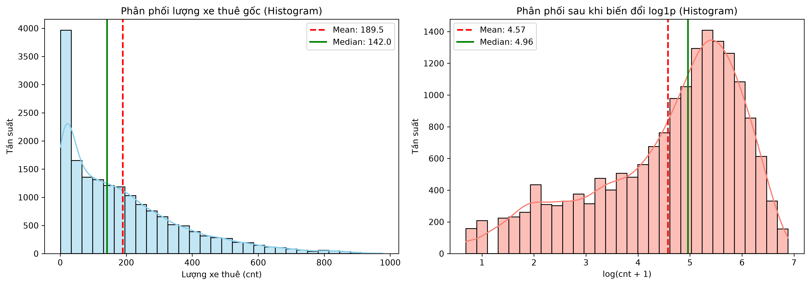
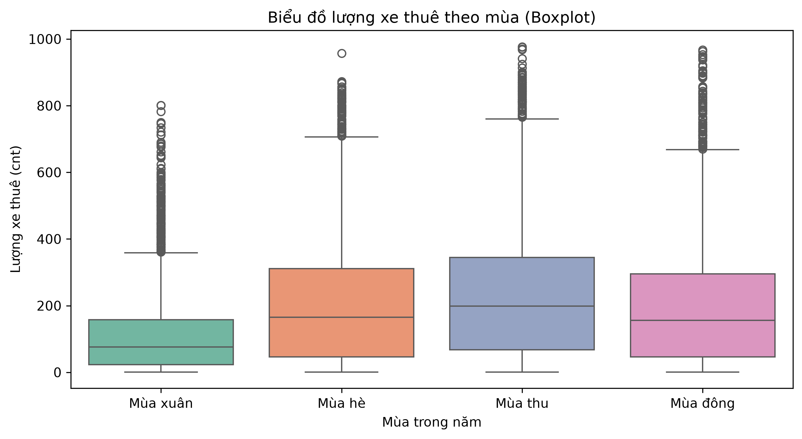
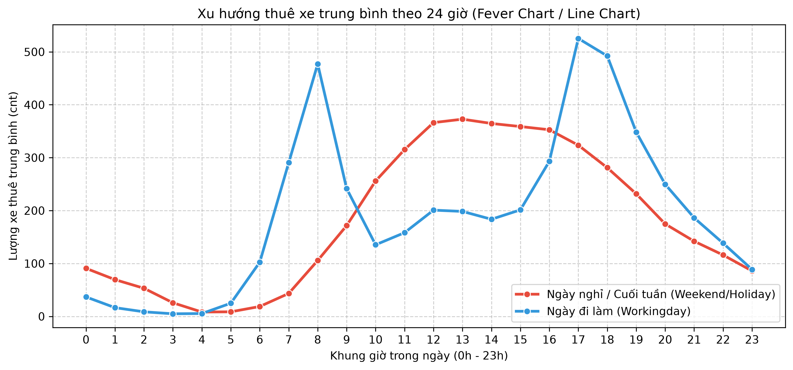
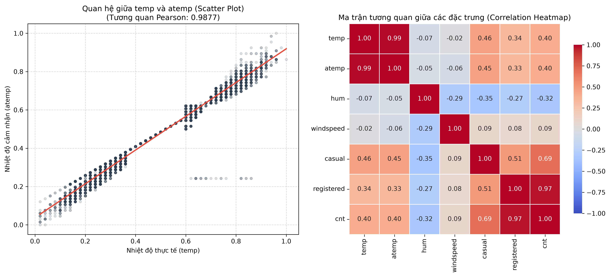

# MỤC 4: PHƯƠNG PHÁP ĐỀ XUẤT (PROPOSED METHOD)
## PHẦN 1: KHÁM PHÁ VÀ PHÂN TÍCH DỮ LIỆU ĐẦU VÀO (EDA)
*(Dung lượng phân bổ: Trang 11 – 13 trong Báo cáo cuối kỳ, chuẩn cỡ chữ 13)*

---

### 4.1. Tổng quan tập dữ liệu và Kiểm toán chất lượng dữ liệu (Data Auditing)

Trong nghiên cứu này, chúng tôi sử dụng tập dữ liệu **UCI Bike Sharing Dataset** (tệp `hour.csv`) thu thập từ hệ thống chia sẻ xe đạp công cộng *Capital Bikeshare* tại Washington D.C., Hoa Kỳ trong giai đoạn 2 năm (2011 – 2012). Tập dữ liệu gốc bao gồm **17,379 quan sát** tương ứng với 17,379 giờ liên tục và **17 thuộc tính**, bao gồm các biến về thời gian, điều kiện thời tiết khí tượng và sản lượng thuê xe.

**Bảng 4.1: Bảng mô tả chi tiết 17 thuộc tính trong tập dữ liệu `hour.csv`**

| Nhóm thuộc tính | Tên thuộc tính | Kiểu dữ liệu | Miền giá trị | Diễn giải ý nghĩa thực tế |
| :--- | :--- | :---: | :---: | :--- |
| **Định danh & Thời gian** | `instant` | Integer | $1 \to 17,379$ | Chỉ số thứ tự bản ghi (được loại bỏ để tránh gây nhiễu). |
| | `dteday` | Date | 2011-01-01 $\to$ 2012-12-31 | Ngày ghi nhận dữ liệu định dạng YYYY-MM-DD. |
| | `season` | Categorical | $1 \to 4$ | Mùa trong năm: 1: Xuân, 2: Hè, 3: Thu, 4: Đông. |
| | `yr` | Binary | 0, 1 | Năm ghi nhận: 0 ứng với năm 2011, 1 ứng với năm 2012. |
| | `mnth` | Categorical | $1 \to 12$ | Tháng trong năm (từ tháng 1 đến tháng 12). |
| | `hr` | Categorical | $0 \to 23$ | Khung giờ trong ngày (từ 0 giờ đêm đến 23 giờ tối). |
| **Lịch trình sinh hoạt** | `holiday` | Binary | 0, 1 | Ngày nghỉ lễ theo luật định (1: Ngày lễ, 0: Ngày thường). |
| | `weekday` | Categorical | $0 \to 6$ | Ngày trong tuần (0: Chủ nhật, 1: Thứ hai, ..., 6: Thứ bảy). |
| | `workingday` | Binary | 0, 1 | Ngày làm việc bình thường (1: Ngày làm việc; 0: Cuối tuần hoặc ngày lễ). |
| **Khí tượng môi trường** | `weathersit` | Categorical | $1 \to 4$ | 1: Trời trong/ít mây; 2: Sương mù/u ám; 3: Mưa nhỏ/tuyết nhẹ; 4: Mưa to bão táp. |
| | `temp` | Continuous | $[0.02, 1.00]$ | Nhiệt độ môi trường đã chuẩn hóa theo thang đo: $(t - (-8))/(39 - (-8))$. |
| | `atemp` | Continuous | $[0.00, 1.00]$ | Nhiệt độ cảm nhận (feeling temp) đã chuẩn hóa: $(t - (-16))/(50 - (-16))$. |
| | `hum` | Continuous | $[0.00, 1.00]$ | Độ ẩm tương đối thực tế đã chia tỷ lệ cho 100 ($0\% \to 100\%$). |
| | `windspeed` | Continuous | $[0.00, 0.85]$ | Tốc độ gió tự nhiên đã chuẩn hóa bằng cách chia cho 67. |
| **Sản lượng thuê xe** | `casual` | Integer | $0 \to 367$ | Lượng khách vãng lai (khách không có thẻ thành viên tháng). |
| | `registered` | Integer | $0 \to 886$ | Lượng khách hàng thân thiết (đã đăng ký thành viên). |
| | **`cnt` (Target)** | **Integer** | $\mathbf{1 \to 977}$ | **Tổng số lượng xe đạp được thuê trong giờ ($cnt = casual + registered$).** |

#### Thực hành nguyên tắc "Know Your Data" phát hiện lỗi cảm biến
Khi tiến hành kiểm tra giá trị khuyết hình thức thông qua hàm `df.isnull().sum()`, kết quả trả về bằng $0$ trên toàn bộ 17 cột dữ liệu. Tuy nhiên, tuân thủ nguyên tắc cốt lõi **"Know Your Data" (Thấu hiểu sâu sắc bản chất vật lý của dữ liệu)**, chúng tôi tiến hành kiểm toán thống kê mô tả miền giá trị thông qua hàm `df.describe().T`.

Kết quả phát hiện giá trị nhỏ nhất của biến độ ẩm (`hum`) đạt ngưỡng cực trị $0.00$ ($0\%$). Trong khí tượng học thực tế tại khu vực bán đảo duyên hải Washington D.C., độ ẩm tương đối của không khí ngoài trời không bao giờ đạt ngưỡng $0\%$ tuyệt đối. Qua phân tích chi tiết, chúng tôi xác định chính xác **22 bản ghi có độ ẩm bằng 0** (chiếm tỷ lệ nhỏ khoảng $0.13\%$), diễn ra liên tục vào ngày **10/03/2011**. Điều này minh chứng cho sự cố ngắt kết nối hoặc lỗi phần cứng của cảm biến khí quyển (sensor malfunction), thay vì trả về giá trị thực hoặc mã lỗi `NaN`, thiết bị đã ghi nhận giá trị mặc định là 0. Các dòng lỗi này sẽ được khắc phục triệt để ở giai đoạn tiền xử lý dữ liệu.

---

### 4.2. Phân tích phân phối của biến mục tiêu và Biến đổi Logarit (Log Transformation)

Biến phụ thuộc mục tiêu $Y$ (`cnt`) thể hiện tổng số lượng xe đạp được điều phối trong một khung giờ nhất định. Việc khảo sát hình thái phân phối xác suất của biến mục tiêu có ý nghĩa quyết định đến việc lựa chọn mô hình và xây dựng hàm mất mát.

*Hình 4.1: Biểu đồ Histogram kiểm tra độ lệch phân phối của biến `cnt` gốc (trái) và sau khi áp dụng hàm biến đổi $\text{log1p}$ (phải).*

Qua biểu đồ Histogram (Hình 4.1 - bên trái), phân phối của biến `cnt` bị **lệch phải rất nặng (Right-skewed / Positive skewness)**. Bằng chứng định lượng thể hiện qua sự chênh lệch rõ rệt giữa hai đại lượng xu hướng tập trung:
$$\text{Mean } (189.5) > \text{Median } (142.0)$$

Đa số thời gian trong ngày (chiếm hơn $50\%$ số giờ), nhu cầu thuê xe chỉ dao động ở mức thấp dưới 142 xe (đặc biệt là các khung giờ đêm khuya và rạng sáng). Tuy nhiên, cái đuôi phân phối kéo dài về bên phải tới các giá trị cực đại gần 1.000 xe vào các khung giờ cao điểm đã làm giá trị trung bình bị kéo lệch lên mức 189.5.

#### Cơ sở toán học của biến đổi hàm $\text{log1p}$
Các mô hình hồi quy tuyến tính cổ điển (Linear Regression, Ridge, Lasso) đều ngầm dựa trên giả định phần dư sai số tuân theo phân phối chuẩn (Normality assumption). Một biến mục tiêu bị lệch phải nghiêm trọng sẽ khiến mô hình bị chi phối bởi các giá trị quá lớn, dẫn đến hiện tượng phương sai sai số thay đổi (Heteroscedasticity).

Để khắc phục hiện tượng này, chúng tôi áp dụng phép biến đổi logarit tự nhiên mở rộng:
$$y' = \text{log1p}(y) = \ln(1 + y)$$

Việc bổ sung thêm hằng số $1$ vào biểu thức logarit nhằm giải quyết triệt để trường hợp $y = 0$, ngăn ngừa lỗi toán học $\ln(0) = -\infty$. Như thể hiện trên Hình 4.1 (bên phải), hàm $\text{log1p}$ với đặc tính đạo hàm giảm dần đã nén mạnh các giá trị cực lớn ở đuôi phải về gần tâm, đưa phân phối của $y'$ về dạng hình chuông cân đối (tiệm cận phân phối chuẩn Gauss) với $\text{Mean} \approx 4.58$ và $\text{Median} \approx 4.96$. Điều này giúp các mô hình hồi quy tuyến tính ước lượng các trọng số $\hat{\beta}$ ổn định và tối ưu hơn đáng kể.

---

### 4.3. Nhận diện các điểm dị biệt (Outlier Detection) theo Mùa

Sự biến thiên thời tiết qua 4 mùa là yếu tố ngoại sinh ảnh hưởng trực tiếp đến hành vi di chuyển bằng xe đạp. Chúng tôi sử dụng biểu đồ Hộp (Boxplot) để phát hiện các điểm ngoại lai theo từng mùa dựa trên phương pháp **Khoảng tứ phân vị (Interquartile Range - IQR)** của John Tukey.

*Hình 4.2: Biểu đồ Boxplot khảo sát mức độ tập trung và các điểm ngoại lai của lượng xe thuê theo 4 mùa trong năm.*

Một điểm dữ liệu $y$ được xác định là ngoại lai phía trên (Upper Outlier) nếu:
$$y > Q_3 + 1.5 \times IQR \quad (\text{với } IQR = Q_3 - Q_1)$$

**Bảng 4.2: Bảng thống kê chi tiết các điểm ngoại lai theo mùa theo tiêu chuẩn IQR**

| Mùa trong năm | Tổng số giờ quan sát | Tứ phân vị $Q_1$ | Trung vị $Median$ | Tứ phân vị $Q_3$ | Ngưỡng râu trên ($Q_3 + 1.5 \times IQR$) | Số lượng điểm ngoại lai | Tỷ lệ ngoại lai (%) |
| :--- | :---: | :---: | :---: | :---: | :---: | :---: | :---: |
| **Mùa xuân** | 4,242 | 23.0 | 76.0 | 158.0 | **360.5** xe | **195** | 4.60% |
| **Mùa hè** | 4,409 | 46.0 | 165.0 | 311.0 | **708.5** xe | **73** | 1.66% |
| **Mùa thu** | 4,496 | 68.0 | 199.0 | 345.0 | **760.5** xe | **98** | 2.18% |
| **Mùa đông** | 4,232 | 46.0 | 155.5 | 295.0 | **668.5** xe | **112** | 2.65% |
| **Toàn bộ dữ liệu**| **17,379** | — | — | — | — | **478** | **2.75%** |

#### Phân tích chuyên sâu về các điểm ngoại lai
Từ Hình 4.2 và Bảng 4.2, chúng tôi rút ra ba phát hiện quan trọng:
1. **Mặt bằng nhu cầu:** Nhu cầu thuê xe đạt đỉnh vào Mùa thu (Trung vị 199 xe) và Mùa hè (165 xe) nhờ nhiệt độ ấm áp thuận lợi, trong khi Mùa xuân có mức sử dụng thấp nhất (Trung vị chỉ 76 xe) do thời tiết đầu năm còn rét buốt.
2. **Số lượng điểm ngoại lai:** Mùa xuân (195 điểm) và Mùa đông (112 điểm) là hai mùa chiếm số lượng ngoại lai áp đảo. Nguyên nhân là do mặt bằng tiêu dùng chung của mùa xuân và mùa đông thấp khiến ngưỡng trần an toàn bị hạ xuống mức $360.5$ xe và $668.5$ xe. Do đó, bất kỳ ngày đẹp trời nào có nhu cầu tăng cao đột xuất đều bị công thức toán học đẩy thành điểm ngoại lai.
3. **Mức độ cực đoan:** Cả 4 mùa đều ghi nhận các điểm ngoại lai vọt lên ngưỡng kỷ lục (Mùa đông lên đến 967 xe, ngang ngửa Mùa hè 968 xe và Mùa thu 977 xe). 

**Tác động đến mô hình học máy:** Các điểm ngoại lai này tạo ra mức sai số $(y - \hat{y})^2$ khổng lồ làm méo mó các đường hồi quy tuyến tính. Đặc biệt đối với thuật toán **AdaBoost**, cơ chế tự động tăng mạnh trọng số mẫu cho các quan sát có sai số dự đoán lớn sẽ khiến AdaBoost bị "dắt mũi", dồn toàn bộ năng lực học vào các điểm ngoại lai cực đoan này, dẫn tới hiện tượng **Học vẹt (Overfitting)** nghiêm trọng. Do đó, việc áp dụng bộ lọc IQR để cắt bỏ hoặc làm mịn ngoại lai ở giai đoạn tiền xử lý dữ liệu là vô cùng cần thiết.

---

### 4.4. Phân tích chu kỳ thời gian 24 giờ và Quy luật Giờ cao điểm (Rush Hours)

Khác với tệp `day.csv`, tệp `hour.csv` cho phép nghiên cứu sự dao động nhu cầu ở độ phân giải mịn theo 24 khung giờ trong ngày ($0 \to 23$).

*Hình 4.3: Biểu đồ Fever Chart / Line Chart thể hiện lượng xe thuê trung bình theo 24 giờ giữa Ngày đi làm và Ngày nghỉ cuối tuần.*

Quan sát Hình 4.3, chúng tôi phát hiện hành vi sử dụng xe đạp hoàn toàn bị chi phối bởi tính chất ngày làm việc:
* **Ngày làm việc (Workingday - đường màu xanh):** Đồ thị xuất hiện **hai đỉnh nhọn đặc trưng (Fever peaks)**:
  - **Đỉnh sáng:** Lúc **08:00** đạt mức trung bình gần 480 xe/giờ (người dân đi làm, học sinh đi học).
  - **Đỉnh chiều:** Lúc **17:00 – 18:00** đạt mức cực đại trên 500 xe/giờ (giờ tan sở về nhà).
  - Khung giờ giữa trưa (10:00 – 15:00) nhu cầu duy trì ở mức thấp ổn định (~200 xe).
* **Ngày nghỉ / Cuối tuần (Weekend/Holiday - đường màu đỏ):** Hoàn toàn triệt tiêu mô hình 2 đỉnh nhọn. Đồ thị chuyển thành **đường cong hình vòm thoai thoải** đạt đỉnh duy nhất vào khoảng **12:00 – 16:00** (nhu cầu đi dạo, thể thao, du lịch cuối tuần).

**Đề xuất Kỹ thuật đặc trưng (Feature Engineering):** Phát hiện này là căn cứ thực nghiệm quyết định để chúng tôi sáng tạo ra biến nhị phân mới:
$$\text{is\_rush\_hour} = 
\begin{cases} 
1 & \text{nếu } \text{workingday} = 1 \text{ và } \text{hr} \in \{7, 8, 9, 17, 18, 19\} \\ 
0 & \text{ngược lại} 
\end{cases}$$
Đặc trưng này sẽ cung cấp tín hiệu mạnh mẽ giúp mô hình nắm bắt tức thì các cú nhảy vọt nhu cầu theo giờ cao điểm.

---

### 4.5. Phân tích ma trận tương quan, Hiện tượng Đa cộng tuyến và Rò rỉ dữ liệu

Nhằm kiểm tra mối liên hệ tuyến tính giữa các biến đầu vào và phát hiện các rủi ro thống kê, chúng tôi xây dựng ma trận tương quan Pearson và biểu đồ phân tán (Hình 4.4).

*Hình 4.4: Biểu đồ Scatter Plot phân tích mối quan hệ giữa `temp` và `atemp` (trái) cùng Ma trận tương quan nhiệt Correlation Heatmap giữa các thuộc tính số học (phải).*

#### 1. Hiện tượng Đa cộng tuyến hoàn hảo giữa `temp` và `atemp`
Qua biểu đồ phân tán (Hình 4.4 - bên trái), các cặp điểm $(\text{temp}, \text{atemp})$ tạo thành một đường thẳng chéo hoàn hảo với hệ số tương quan đạt mức gần như tuyệt đối:
$$r(\text{temp}, \text{atemp}) = 0.9877 \approx \mathbf{0.99}$$

**Bản chất lý thuyết thống kê:** Trong hồi quy tuyến tính cổ điển (OLS), vector ước lượng trọng số được tính bằng công thức:
$$\hat{\beta} = (X^T X)^{-1} X^T Y$$
Khi tồn tại hai biến độc lập tương quan xấp xỉ $1.0$, ma trận Gram $(X^T X)$ sẽ rơi vào tình trạng **gần suy biến (Ill-conditioned / Singular matrix)** với định thức xấp xỉ bằng $0$. Hệ quả là ma trận nghịch đảo $(X^T X)^{-1}$ có các phần tử trên đường chéo chính bùng nổ, khiến phương sai của các hệ số hồi quy:
$$\text{Var}(\hat{\beta}_j) = \sigma^2 \cdot \left[ (X^T X)^{-1} \right]_{jj} \to \infty$$
Điều này khiến mô hình mất hoàn toàn tính ổn định, hệ số ước lượng dao động mạnh khi dữ liệu thay đổi nhỏ, dấu của trọng số bị đảo ngược và mất khả năng diễn giải. Do đó, **việc loại bỏ biến `atemp` ở giai đoạn tiền xử lý là bắt buộc** để triệt tiêu hiện tượng đa cộng tuyến.

#### 2. Cảnh báo nguy cơ Rò rỉ dữ liệu (Data Leakage)
Quan sát ma trận tương quan nhiệt (Hình 4.4 - bên phải), biến mục tiêu `cnt` có tương quan tuyến tính rất mạnh với `casual` ($r = 0.69$) và đặc biệt là `registered` ($r = 0.97$).
Vì bản chất của bài toán thực tế là:
$$\text{cnt} = \text{casual} + \text{registered}$$
Nếu người xây dựng mô hình giữ lại hai biến `casual` và `registered` trong ma trận đặc trưng $X$, mô hình sẽ bị **Rò rỉ dữ liệu (Data Leakage / Target Contamination)**. Thuật toán sẽ chỉ việc thực hiện phép cộng đơn giản giữa hai cột này để đạt độ chính xác $100\%$ mà không học được bất kỳ quy luật nào từ thời tiết hay thời gian. Do đó, cả hai biến `casual` và `registered` cùng biến định danh `instant`, `dteday` **bắt buộc phải bị xóa bỏ hoàn toàn khỏi tập đặc trưng huấn luyện**.

---
*(Hết Phần 1 Mục 4. Toàn bộ các phát hiện trên là tiền đề trực tiếp để triển khai Giai đoạn tiền xử lý dữ liệu và tạo đặc trưng ở phần tiếp theo).*
